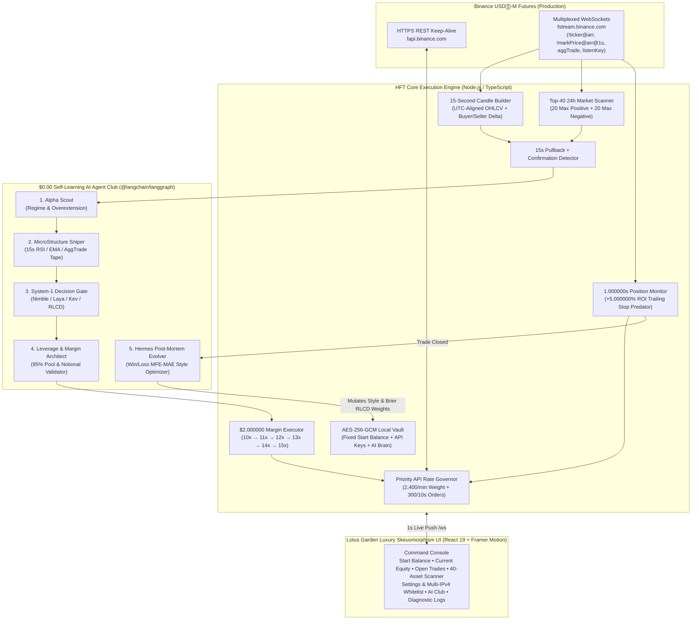

<div align="center">
  

  <br />

  [](https://www.binance.com/en/futures)
  [](#3-real-time-15-second-candle-engine--pullback-strategy)
  [-EBAEE6?style=for-the-badge)](#5-zero-cost-self-learning-ai-agent-club)
  [](#6-lotus-garden-luxury-skeuomorphism-uiux)
</div>

---

# HFT — Automation Trading Bot (`USDⓈ-M Real Production`)

> **Trade Smarter • Grow Faster**  
> **Copyright © & Developed by Trading Lifestyle Quant.**

**HFT** is a real-money, production-grade **Binance USDⓈ-M Futures (`fapi.binance.com` & `fstream.binance.com`)** automated High-Frequency Trading environment engineered for ultra-fast micro-pullback execution on **15-second candles**, **1-second open-position monitoring**, **fee-aware Net PNL tracking**, and **$0.00 zero-cost autonomous self-learning** via a 5-agent **LangGraph** state machine and **System-1 Typed Decision Primitives (`Nimble` / `Laya` / `Kev` / Brier RLCD)**.

> **Important Production Notice**: This system connects directly to **live production Binance USDⓈ-M Futures** (not a simulation and not Testnet). Trades execute immediately once you save your Binance API Key & Secret Key in **Settings & IPs** and toggle **ARM ENGINE**.

---

## Table of Contents

1. [System Architecture](#1-system-architecture)
2. [Core Trading Rules & Capital Mechanics](#2-core-trading-rules--capital-mechanics)
3. [Real-Time 15-Second Candle Engine & Pullback Strategy](#3-real-time-15-second-candle-engine--pullback-strategy)
4. [1-Second Open Position Monitor & 5% ROI Trailing Stop](#4-1-second-open-position-monitor--5-roi-trailing-stop)
5. [Zero-Cost Self-Learning AI Agent Club](#5-zero-cost-self-learning-ai-agent-club)
6. [Lotus Garden Luxury Skeuomorphism UI/UX](#6-lotus-garden-luxury-skeuomorphism-uiux)
7. [Multi-IPv4 Whitelist Discovery (PC & Multi-IP Servers)](#7-multi-ipv4-whitelist-discovery-pc--multi-ip-servers)
8. [Quickstart — Localhost PC Setup](#8-quickstart--localhost-pc-setup)
9. [Production Deployment — Online VPS / Dedicated Server](#9-production-deployment--online-vps--dedicated-server)
10. [Optional Local System-1 Models (`Nimble`, `Laya`, `Kev`, `Ollama`)](#10-optional-local-system-1-models-nimble-laya-kev-ollama)
11. [REST & WebSocket API Reference](#11-rest--websocket-api-reference)
12. [Repository Structure & Security](#12-repository-structure--security)

---

## 1. System Architecture



---

## 2. Core Trading Rules & Capital Mechanics

| Parameter | Specification | Implementation Details |
| :--- | :--- | :--- |
| **Exchange Market** | Binance USDⓈ-M Perpetuals (`USDT`) | Filters active `TRADING` `PERPETUAL` `USDT`-margined contracts via `/fapi/v1/exchangeInfo`. Automatically supports **One-Way Mode** & **Hedge Mode** (`/fapi/v1/positionSide/dual`). |
| **Universe Size** | **40 Assets** (`20` Positive + `20` Negative) | Ranks 24h `priceChangePercent` continuously: Top 20 gainers (`LONG` only) and Top 20 losers (`SHORT` only). |
| **Execution Timeframe** | **15-Second (`15s`) Candles** | Real-time UTC-aligned `15,000ms` candles constructed from `<symbol>@aggTrade` WebSocket ticks + `/fapi/v1/aggTrades` warmup. |
| **Base Margin / Trade** | **`$2.000000` USDT** | Dedicated base margin per position entry. |
| **Leverage Fallback Ladder** | **`10x → 11x → 12x → 13x → 14x → 15x`** | Attempts `10x` first. If order execution, `MIN_NOTIONAL`, or `LOT_SIZE` `minQty`/`stepSize` fails at `10x`, automatically escalates `11x`, `12x`, `13x`, `14x`, up to `15x`. |
| **Profit Target & Trail** | **`+5.000000%` ROI → Trailing Stop** | The instant ROI hits `+5.000000%`, Trailing Stop arms, locks a fee-positive profit floor, and trails peak ROI dynamically to capture maximum profit. |
| **Open Trade Check** | **Every `1.000000` Second** | Dedicated 1-second heartbeat reconciled with `/fapi/v2/positionRisk` + `!markPrice@arr@1s` WebSocket ticks. |
| **Capital Allocation Cap** | **`95.000000%` of Equity** | Uses up to 95% of balance for trade execution. When free budget in the 95% pool drops below `$2.000000`, **Market Scanner automatically pauses** and focuses 100% on open running positions. |
| **Start Balance Rule** | **Fixed on 1st API Connection** | Captured automatically the very first time Binance API connects and locked permanently until you click **Reset Start Balance** in Settings. |
| **Numeric Precision** | **Strict `0.000000` (6 Decimals)** | Every balance, price, ROI %, Gross PNL, Binance Fee, Net PNL, and telemetry figure renders with exact 6-decimal formatting. |

---

## 3. Real-Time 15-Second Candle Engine & Pullback Strategy

Because Binance USDⓈ-M Futures REST `/fapi/v1/klines` only supports intervals starting at `1m` (requesting `15s` on REST klines returns `-1120 Invalid interval`), **HFT** includes a native institutional **15-Second Tick-to-Bar Aggregator (`server/binance/candleBuilder15s.ts`)**:

- Buckets every `<symbol>@aggTrade` event into exact `:00`, `:15`, `:30`, and `:45` UTC boundaries.
- Separates aggressive market buyer volume (`!isBuyerMaker`) from aggressive market seller volume (`isBuyerMaker`) to compute real-time **Orderflow Delta Ratios**.
- Computes fast `EMA(9)`, `EMA(21)`, `RSI(7)`, `ATR(10)%`, and 14-bar swing high/low pullback depth.

### Entry Logic (`server/engine/strategy15s.ts`)
1. **Maximum Positive 24h Movers (`Top 20 Gainers` → `LONG`)**:
   - Waits for a controlled **15-second pullback** from recent local high (`RSI(7)` cooling into pullback zone / red retracement bar testing `EMA(9)` while holding macro `EMA(21)` support).
   - Executes **Market LONG** immediately upon a **15s bullish confirmation candle** (bullish body reclaim or lower-wick hammer rejection + positive `aggTrade` buyer delta confirmation).
2. **Maximum Negative 24h Movers (`Top 20 Losers` → `SHORT`)**:
   - Waits for a **15-second relief bounce** off local low (`RSI(7)` rising into bounce zone / green retracement bar testing `EMA(9)` while capped by `EMA(21)` resistance).
   - Executes **Market SHORT** immediately upon a **15s bearish confirmation candle** (bearish breakdown body or upper-wick shooting-star rejection + aggressive `aggTrade` seller delta confirmation).

---

## 4. 1-Second Open Position Monitor & 5% ROI Trailing Stop

Every open position is inspected every **`1.000000` second** (`server/engine/positionMonitor1s.ts`) and displays all 9 required live telemetry columns on the dashboard:

1. **Asset Name** (`e.g., SOLUSDT`)
2. **Long / Short** (`LONG` or `SHORT` + active leverage `10x–15x`)
3. **Entry Price** (`0.000000`)
4. **Mark Price** (`0.000000`)
5. **ROI (%)** (`(Gross PNL / Initial Margin) × 100`, `0.000000%`)
6. **PNL (Gross USDT)** (`0.000000`)
7. **Binance Platform Fees** (`Entry Commission + Estimated Exit Commission` queried per symbol via `/fapi/v1/commissionRate`, `0.000000`)
8. **Net PNL** (`Gross PNL - Binance Platform Fees`, `0.000000`)
9. **Running Trade Time** (`HH:MM:SS (0.000000s)`)

Once `ROI >= +5.000000%`, the **Trailing Stop Predator** activates, locks a minimum profit floor above round-trip Binance taker fees, tracks `peakRoiPct` every second, and fires an instant market close (`reduceOnly` in One-Way mode / matched `positionSide` in Hedge mode) when momentum reverses.

---

## 5. Zero-Cost Self-Learning AI Agent Club

Built on **`@langchain/langgraph`** (`server/ai/agentClubGraph.ts`) + **System-1 Typed Decision Primitives** (`server/ai/system1Primitives.ts`) at **`$0.00` API cost**:

### The 5 Specialized Agents
1. **Alpha Scout** (*LangGraph + CrewAI Role*): Screens 24h momentum regime quality and filters extreme blow-off overextensions.
2. **MicroStructure Sniper** (*LangGraph + Agent-Zero Pattern*): Verifies 15s candle pullback depth, `RSI(7)`, wick rejection, and `aggTrade` buyer/seller delta conviction.
3. **System-1 Decision Gate** (*Nimble / Laya / Kev Architecture*): Executes single-pass typed `noul` (yes/no), `choice`, and temperature-scaled `score` probability decisions in `<0.3ms` locally.
4. **Leverage & Margin Architect** (*LangGraph + AutoGen Verifier*): Enforces the `$2.000000` margin rule, `95.000000%` equity pool cap, and arms the `10x → 15x` escalation ladder.
5. **Hermes Post-Mortem Evolver** (*LangGraph + Hermes Self-Evolution*): Runs automatically after **every closed trade (Win or Loss)**:
   - Audits **Maximum Favorable Excursion (MFE)** vs **Maximum Adverse Excursion (MAE)** and **Binance Fee Drag**.
   - Generates a human-readable forensic report (*What Worked Best* & *What We Missed*).
   - Updates live strategy parameters (`trailingCallbackRoiPct`, `trailingFloorRoiPct`, `pullbackRsiLongMax`, `pullbackRsiShortMin`, `minOrderflowDeltaRatio`, `minAiConfidenceScore`, `max24hOverextensionPct`) and updates System-1 weights via **Strictly Proper Brier Score Online Gradient Descent (RLCD)**.
   - Appends real contrastive training pairs to `./data/nimble_kev_training_pairs.jsonl`.

---

## 6. Lotus Garden Luxury Skeuomorphism UI/UX

Designed around a clean, focused hardware console aesthetic paired with the **Lotus Garden** color palette:

| Color Swatch | Hex | UI / UX Role |
| :--- | :--- | :--- |
| **Lotus Mint Jade** | `#ADEBB3` | `LONG` badges, Top 20 Positive Movers, Positive ROI/Net PNL, Live Mint LEDs, `ENGINE ARMED` switch |
| **Lotus Coral Petal** | `#FF857A` | `SHORT` badges, Top 20 Negative Movers, Risk/Stop Alerts, `95% Capital Pause` banner, Manual Close |
| **Lotus Orchid Blossom** | `#EBAEE6` | Brand highlights, Fixed Start Balance lock, `+5.000000%` Trailing Armed glow, AI Agent Club telemetry |
| **Lotus Rosewood Earth** | `#6B403C` | Brushed rosewood-mahogany skeuomorphic chassis, raised tactile push-buttons, rose-bronze corner rivets |

The primary screen remains pure and distraction-free—displaying **only** your **Start Balance**, **Current Equity**, **Open Trades**, and **40-Asset Market Scanner**—while **AI Club**, **System & Error Logs**, and **Vault Settings & Whitelist IPs** open cleanly via physical tactile switches in the header.

---

## 7. Multi-IPv4 Whitelist Discovery (PC & Multi-IP Servers)

To prevent critical Binance `-2015 Invalid API-key, IP, or permissions` rejections:
- `server/utils/ipDiscovery.ts` enumerates **every non-loopback network interface** (`os.networkInterfaces()`) AND performs **per-interface socket-bound (`localAddress`) outbound IPv4 probes** across multiple independent echo endpoints (`ipify`, `icanhazip`, `amazonaws`, `ident.me`).
- If your online dedicated/cloud server has **multiple public IPv4 addresses**, **all of them** are displayed in **Settings & IPs** with a **1-click Copy All Whitelist IPv4s** button (formatted space-separated for direct paste into Binance API Management).
- Multi-IP server operators can also optionally pin all outbound Binance REST & WebSocket connections to a single chosen local interface IPv4 directly from the Settings UI.

---

## 8. Quickstart — Localhost PC Setup

### Prerequisites
- **Node.js `v20+`** (recommended `v22 LTS`) and `npm`
- A real **Binance Account** with **USDⓈ-M Futures** enabled and an API Key with **"Enable Futures"** checked (*never enable Withdrawal permissions*).

### Step-by-Step Commands

```bash
# 1. Clone the repository
git clone https://github.com/badalworld/hft.git
cd hft

# 2. Install dependencies
npm install

# 3. Optional: copy environment configuration
cp .env.example .env

# 4. Run quantitative & execution engine self-tests
npm test

# 5. Start the live HFT server + UI (http://localhost:3000)
npm run dev
```

1. Open **`http://localhost:3000`** in your browser.
2. Click **Settings & IPs** (top right) and copy your detected **Public Outbound IPv4 Address(es)** into your Binance API Key IP Whitelist.
3. Paste your **Binance API Key** and **Binance Secret Key** and click **Save & Connect Live API**. Your **Start Balance** will automatically capture and lock on first connection.
4. Click **ARM ENGINE** in the top header to begin live 15-second automated trading.

---

## 9. Production Deployment — Online VPS / Dedicated Server

**HFT** runs as a unified single-port production server (`0.0.0.0:3000`) serving the execution engine, REST API, `/ws` real-time telemetry stream, and compiled frontend bundle:

```bash
# 1. Install dependencies & build optimized frontend assets
npm install
npm run build

# 2. Launch with PM2 for 24/7 auto-restart & crash resilience
npm install -g pm2
pm2 start ecosystem.config.cjs
pm2 save
pm2 startup
```

### Optional Nginx Reverse Proxy (HTTPS + WebSocket `/ws`)

```nginx
server {
    listen 80;
    server_name your-trading-domain.com;

    location / {
        proxy_pass http://127.0.0.1:3000;
        proxy_http_version 1.1;
        proxy_set_header Upgrade $http_upgrade;
        proxy_set_header Connection "upgrade";
        proxy_set_header Host $host;
        proxy_set_header X-Real-IP $remote_addr;
    }
}
```

---

## 10. Optional Local System-1 Models (`Nimble`, `Laya`, `Kev`, `Ollama`)

Out of the box, **HFT** uses its built-in calibrated **System-1 RLCD Engine** (`~0.2ms` latency, `$0.00` cost, zero GPU required). If you also wish to ensemble a local open-weight System-1 checkpoint on your machine at `$0.00` API cost, open **AI Club** in the dashboard and select:

- **Bespoke Nimble / Hermes via Ollama**:
  ```bash
  ollama pull nimble
  # Select "Local Ollama" -> http://127.0.0.1:11434 -> model: nimble
  ```
- **Laya Non-Autoregressive Decision Server**:
  ```bash
  pip install "laya[serve]"
  laya serve --port 8000
  # Select "Local Laya HTTP Server" -> http://127.0.0.1:8000
  ```
- **Kev System-One Server**:
  ```bash
  # Run Kev checkpoint server locally on port 8080
  # Select "Local Kev System-One Server" -> http://127.0.0.1:8080
  ```

---

## 11. REST & WebSocket API Reference

| Method & Path | Description |
| :--- | :--- |
| `GET /api/health` | Engine liveness check & build metadata |
| `GET /api/snapshot` | Full real-time `DashboardSnapshot` (balances, open trades, 40 scanner assets, AI Club, rate limits, IPs) |
| `POST /api/engine/toggle` | Arm (`{ running: true }`) or pause (`{ running: false }`) automated order entries |
| `POST /api/settings/credentials` | Encrypt & store `{ apiKey, apiSecret }` in AES-256-GCM vault and connect to Binance Futures |
| `POST /api/settings/reset-start-balance` | Reset & re-lock the fixed Start Balance to current live Binance wallet balance |
| `POST /api/settings/rescan-ips` | Re-probe all server network interfaces and outbound public IPv4 addresses |
| `POST /api/settings/bind-ip` | Pin outbound Binance HTTP/WS sockets to a specific local NIC IPv4 (`{ localAddress }`) |
| `POST /api/settings/local-ai` | Switch System-1 runtime (`builtin`, `ollama_nimble`, `laya_http`, `kev_http`) |
| `POST /api/positions/close` | Immediately market-close an open trade (`{ symbol, positionSide }`) |
| `GET /api/logs` | Query structured execution, API, AI, and error logs |
| `GET /api/logs/export` | Download complete plain-text `.log` diagnostic file |
| `WS /ws` | Real-time push stream (`INIT`, 1-second `SNAPSHOT`, and instant `LOG` frames) |

---

## 12. Repository Structure & Security

```text
hft/
├── public/
│   ├── favicon.svg               # HFT Candlestick + Breakout Arrow icon
│   └── logo-banner.svg           # Full HFT Automation Trading Bot hero banner
├── server/
│   ├── index.ts                  # Unified Express + WS (/ws) + Static/Vite server (0.0.0.0)
│   ├── types.ts                  # Strict domain & telemetry TypeScript definitions
│   ├── ai/
│   │   ├── system1Primitives.ts  # System-1 RLCD engine, Brier updates & Nimble/Laya/Kev adapters
│   │   └── agentClubGraph.ts     # @langchain/langgraph 5-Agent Entry & Post-Mortem StateGraphs
│   ├── binance/
│   │   ├── rateGovernor.ts       # Priority-tiered 2,400/min API weight & order governor
│   │   ├── restClient.ts         # Persistent Keep-Alive HMAC-SHA256 Binance FAPI client
│   │   ├── wsStreamManager.ts    # Multiplexed fstream.binance.com WebSocket manager
│   │   └── candleBuilder15s.ts   # Real-time 15-second OHLCV + Orderflow Delta aggregator
│   ├── engine/
│   │   ├── stateStore.ts         # Atomic encrypted vault & persistent Start Balance / AI brain
│   │   ├── marketScanner.ts      # Top-40 (20 Pos / 20 Neg) 24h USDT-M scanner + 95% pause logic
│   │   ├── strategy15s.ts        # 15s Pullback + Bullish/Bearish Confirmation detector
│   │   ├── positionMonitor1s.ts  # 1s Open Position check, Binance Fees, Net PNL & 5% ROI Trail
│   │   └── hftBotEngine.ts       # Master HFT orchestrator & 10x→15x leverage fallback ladder
│   └── utils/
│       ├── cryptoVault.ts        # AES-256-GCM credential encryption at rest
│       ├── format.ts             # 0.000000 formatting & exact LOT_SIZE step precision math
│       ├── ipDiscovery.ts        # Multi-NIC & multi-egress IPv4 discovery engine
│       └── logger.ts             # Ring-buffer + daily file-persisted diagnostic logger
├── src/
│   ├── App.tsx                   # Clean Lotus Garden luxury command console
│   ├── index.css                 # Lotus Garden skeuomorphic design system (#ADEBB3/#FF857A/#EBAEE6/#6B403C)
│   ├── components/
│   │   ├── HftBrandLogo.tsx      # Vector HFT Candlestick + Breakout Arrow logo lockup
│   │   ├── HeaderChassis.tsx     # Top hardware chassis, API weight diode & Master Engine switch
│   │   ├── EquityBezel.tsx       # Fixed Start Balance & Current Equity OLED bezel + 95% pool bar
│   │   ├── OpenTradesDeck.tsx    # Live 1s Open Trades table with fees, Net PNL & trailing badge
│   │   ├── MarketScannerDeck.tsx # Dual-bank 40-asset scanner with 15s pullback/confirmation states
│   │   ├── AiAgentClubModal.tsx  # 5-Agent LangGraph council, post-mortems & System-1 config
│   │   ├── SettingsVaultModal.tsx# API credentials vault, Multi-IPv4 whitelist & Start Balance reset
│   │   └── SystemLogsDrawer.tsx  # Filterable & downloadable execution/error log console
│   ├── hooks/
│   │   └── useHftRealtime.ts     # WebSocket (/ws) + REST state synchronization hook
│   └── utils/
│       └── format.ts             # Strict 6-decimal UI formatters
├── scripts/
│   └── selfTest.ts               # Automated verification suite for strategy, trailing stop & AI Club
├── ecosystem.config.cjs          # PM2 production process configuration
└── .env.example                  # Environment configuration template
```

### Security Guarantees
- `./data/` (containing encrypted API credentials, daily logs, and contrastive trade journals) and `.env` are strictly excluded via `.gitignore` and **never committed to Git**.
- Binance API credentials are encrypted at rest using **AES-256-GCM** (`scrypt` key derivation).
- All Binance outbound sockets enforce `family: 4` (IPv4) so requests deterministically match your whitelisted IPv4 address(es).

---

<div align="center">
  <strong>HFT — Automation Trading Bot</strong> • <em>Trade Smarter • Grow Faster</em><br />
  Copyright © & Developed by <strong>Trading Lifestyle Quant.</strong>
</div>
