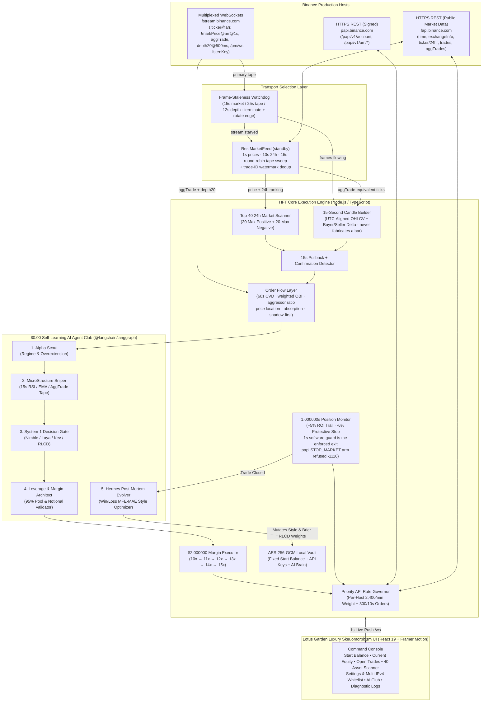

<div align="center">
  

  <br />

  [](#whats-new-in-v161)
  [-F0B90B?style=for-the-badge)](https://www.binance.com/en/futures)
  [](#6-real-time-15-second-candle-engine--pullback-strategy)
  [](#4-market-data-transport-resilience-ws--rest-failover)
  [-EBAEE6?style=for-the-badge)](#9-zero-cost-self-learning-ai-agent-club)
  [](#2-execution-ledger--live-verified)
  [](#10-lotus-garden-luxury-skeuomorphism-uiux)
</div>

---

# HFT — Automation Trading Bot (`USDⓈ-M Real Production`)

> **Trade Smarter • Grow Faster**
> **Copyright © & Developed by Trading Lifestyle Quant.**

**HFT** is a real-money, production-grade **Binance Portfolio Margin / USDⓈ-M Futures** (`papi.binance.com`, `fapi.binance.com` & `fstream.binance.com`) automated High-Frequency Trading environment engineered for ultra-fast micro-pullback execution on **15-second candles**, **1-second open-position monitoring**, **fee-aware Net PNL tracking**, and **$0.00 zero-cost autonomous self-learning** via a 5-agent **LangGraph** state machine and **System-1 Typed Decision Primitives (`Nimble` / `Laya` / `Kev` / Brier RLCD)**.

> **Important Production Notice**: This system connects directly to **live production Binance** (not a simulation and not Testnet). Trades execute immediately once you save your Binance API Key & Secret Key in **Settings & IPs** and toggle **ARM ENGINE**.

---

## What's New in `v1.6.1`

**A confidence gate the model cannot reach is not a risk control; it is an outage.** By `2026-10-29T00:05Z` the live book had made `109` settled closes, the learner had spent them shrinking the System-1 feature weights and raising its temperature, and the council had spent them ratcheting `minAiConfidenceScore` from `0.522000` to `0.676000`. Nothing connected those two loops: at the live weights the highest probability the model could express was `0.641479`. The engine stayed armed and refused every entry for hours — `412` consecutive AI Club vetoes, best observed score `0.639993` — while the dashboard correctly reported that no setup qualified. It was not waiting for a better tape. It could not have approved one.

`v1.6.1` makes the gate answer to the model that has to clear it. `attainableSystem1Score()` computes the sigmoid ceiling implied by the current weights and their structural feature caps; `resolveReachableThreshold()` holds the effective gate at `ceiling − 0.01` whenever the configured value crosses it, and every verdict states the clamp in its log line. The configured threshold remains the target — a reachable `0.620000` is untouched — and the override engages only where the value is physically unsatisfiable. A self-test pins the exact collapsed-weight case from this account and asserts that the best feature vector the model can express passes the held gate but can never exceed the ceiling.

Restarting onto `v1.6.0` with the fixed gate produced the first fills in hours: `TAGUSDT` closed `+$0.102432` net on a trailing stop after peaking at `+8.605091%`, and `STARUSDT` closed `-$0.147418` net on the `-6.426735%` software guard. Two live defects were found in the same session and are recorded rather than hidden: the exchange-side `STOP_MARKET` arm is refused by papi with `-1116` because conditional orders live at `/papi/v1/um/conditional/order`, not `/papi/v1/um/order` ([§8](#8-1-second-open-position-monitor--5-roi-trailing-stop)); and the order-flow tape rides the `aggTrade` socket, which delivers no frames on this network, so every shadow verdict reads `NO_SIGNAL` while the REST fallback feeds candles only ([§4](#4-market-data-transport-resilience-ws--rest-failover)).

The clamp is live at the latest capture (`2026-10-29T04:37:01Z`, `111` settled closes, weights after `111` Brier updates, temperature `1.372`): the attainable ceiling is `0.633405`, the configured gate is `0.627000`, and the effective gate is held at `0.623405`. The engine was armed and flat at that moment, with `3` assets in `CONFIRMED_SIGNAL`, `22` in `PULLBACK_DETECTED` and `15` in `MONITORING` — a strategy actively looking, not a gate that cannot open.

## What's New in `v1.6.0`

**A 15-second candle records the result of the auction, never the fight that produced it.** It cannot say whether buyers were lifting offers or sellers were hitting bids, whether the move was accelerating or already exhausted, or whether a wall was quietly absorbing everything thrown at it. `v1.6.0` adds that missing layer: a live order-flow gate built from the top-20 depth book (`@depth20@500ms`) and the executed tape, scoring every `15s` trigger against six checks — fee-plus-spread cost, order-book imbalance, cumulative volume delta level and slope, aggressive buy/sell ratio, price location in its own range, and absorption.

**It ships in `shadow` mode on purpose.** The thresholds below are the starting hypotheses, not a proven edge; the system has no right to refuse real orders on an untested hypothesis. In `shadow` every verdict is scored, counted and written to the tape as `WOULD-ENTER` / `WOULD-BLOCK`, and nothing is blocked. Flipping the vault setting to `enforce` turns the same verdicts into a hard veto with a `20s` symbol cooldown. The mode is operator-only — the council may tune the thresholds, but it cannot vote itself into blocking trades. The full arithmetic and gate order live in [§6](#6-real-time-15-second-candle-engine--pullback-strategy).

The same release replaces the hand-drawn segment glyphs with **DSEG7 Classic Bold**, a self-hosted SIL-OFL seven-segment typeface ([§10](#10-lotus-garden-luxury-skeuomorphism-uiux)), and re-verifies the AI Club against the live book instead of describing it from memory.

### The three indicators, as arithmetic

| Quantity | Definition | What the gate demands |
| :--- | :--- | :--- |
| **Order Book Imbalance** | Top-20 levels, distance-weighted `w_i = 1 / (1 + 0.2i)`, quantity-weighted: `OBI = (Σ w·q_bid − Σ w·q_ask) / (Σ w·q_bid + Σ w·q_ask)` | `≥ +0.20` for `LONG`, `≤ −0.20` for `SHORT` (`orderFlowMinObi`, bounded `0.05–0.6`). A book inside the band is neutral, not weak. |
| **Cumulative Volume Delta** | Quote-denominated, per `1s` bucket: `CVD_t = Σ (buyUsd_i − sellUsd_i)` over the rolling window. Binance's `m` flag is the aggressor: `m=false` is a market **buyer**, `m=true` is a market **seller**. | `CVD > 0` **and** rising for `LONG`; `CVD < 0` **and** falling for `SHORT`. Slope is measured as the window's second half minus its first half, so a positive but fading delta is refused — that is the exhaustion print this layer exists to catch. |
| **Trade Aggression** | `buyUsd / sellUsd` across the same window; `buyAggressionMultiple` compares this window's buy notional against the previous window's. | Ratio `≥ 1.50` for `LONG`; the reciprocal is tested for `SHORT`, so `0.67` is the mirrored `1.50` (`orderFlowMinVolumeRatio`, bounded `1.05–3`). |
| **Liquidity & Absorption** | Aggression compared against its own baseline, price progress over the same window, and the refill ratio of the touch: current touch depth ÷ its own EMA. | Refuses when aggression `≥ 1.60×`, price progress `≤ 0.05%`, **and** the resting touch refilled `≥ 1.05×` its baseline. Heavy flow that cannot move price means the other side is eating it — `ABSORBED_BUYERS` / `ABSORBED_SELLERS`. |
| **Price location** | Position of the last trade inside the window's own high–low range. | `LONG` needs the upper half, `SHORT` the lower half. This is the "reclaims a key level" leg rather than the "breaks a new high" leg: a pullback trigger and a fresh extreme cannot both be true on the same bar. |
| **Spread-inclusive cost** | `costRoiPct = (2 × takerRate × leverage × 100) + (spreadBps / 10,000 × leverage × 100)`. | `expectedRoiPct` must clear `costRoiPct × minFeeHurdleMultiple`. Both terms are linear in leverage, so the ratio is leverage-invariant — no rung of the ladder makes a small move affordable. |

### Six gates, in the order a desk checks them

The strategy class (`server/engine/orderFlowStrategy.ts`) is pure and deterministic. Two data preconditions run before the six: a missing or `>5s`-old depth snapshot returns **`NO_DATA`**, and a tape window with fewer than `5` active seconds returns **`NO_SIGNAL`**. Guessing is never an option; an empty feed is reported as empty.

| # | Gate | Verdict on failure |
| :--- | :--- | :--- |
| 1 | Fee-plus-spread cost vs expected move | `EXECUTION_REJECT` |
| 2 | Order-book imbalance | `OBI_REJECT` |
| 3 | CVD level **and** slope | `CVD_REJECT` |
| 4 | Aggressive buy/sell ratio (reciprocal on `SHORT`) | `RATIO_REJECT` |
| 5 | Price location in the window's range | `PRICE_REJECT` |
| 6 | Absorption against the resting side | `ABSORPTION_REJECT` |

### Shadow first, because these are hypotheses

| | `shadow` (default) | `enforce` |
| :--- | :--- | :--- |
| Entry behaviour | unchanged; the `15s` trigger still decides | a non-confirming verdict vetoes the entry |
| What is recorded | verdict counted in `snapshot.orderFlow.byVerdict`, one log line per symbol+verdict per minute | same, plus `⛔ blocked by order flow` and a `20s` cooldown |
| Log prefix | `SHADOW … would-enter` / `would-block` | `ORDER_FLOW …` |
| Who can change it | operator only — `POST /api/settings/order-flow-mode` or the AI Club toggle | same |

The mode persists in the encrypted vault and defaults to `shadow` on any unrecognised value. The council owns four thresholds — `orderFlowMinObi`, `orderFlowMinVolumeRatio`, `orderFlowWindowSec`, `orderFlowAbsorptionMultiple` — each with a per-parameter step cap, and the absorption multiple is deliberately marked **inverted**: a larger multiple means fewer absorption blocks, which is a loosening, and the council scores it as one. `ADVERSE_TAKER_FLOW` is the one autopsy cause allowed to move the OBI and ratio levers, because that is the evidence those levers encode.

### Where the layer is visible

- **Scanner → `Book / 60s Tape` column** — `OBI`, `CVD`, aggressor ratio and spread in basis points per asset, plus a flow badge on every row (`CONFIRM`, `THIN TAPE`, `NO BOOK`, `OBI ✕`, `CVD ✕`, `RATIO ✕`, `RANGE ✕`, `COST ✕`, `ABSORBED`).
- **AI Club → Order Flow Layer panel** — depth/tape liveness, live books vs watched symbols, would-enter/would-block counters, refusals by gate since boot, current thresholds, and the `shadow`/`enforce` switch.
- **Execution log** — `ORDER_FLOW` lines, rate-limited to one per symbol+verdict per minute so a persistent refusal cannot flood the tape.
- **`snapshot.orderFlow`** — the same telemetry as machine-readable state (`mode`, `confirmed`, `blocked`, `byVerdict`, `liveBooks`, `watchedSymbols`, `depthLive`, `tapeLive`).

The depth socket has its own `12s` data-staleness watchdog and edge rotation, independent of the market and aggTrade sockets; the tape rides the aggTrade stream the candle builder already consumes, so the layer adds exactly one subscription. When either feed dies, the verdict is `NO_DATA` — the gate never invents a book.

### The readout is finally a real LED face

The drawn-segment readout was faithful to the idea of a seven-segment display but not to its geometry: at `22px` the chamfered polygons and `1px` joints blurred into bars. `src/components/SevenSegmentNumber.tsx` now sets every digit in **DSEG7 Classic Bold**, the SIL-OFL typeface designed for exactly this, self-hosted at `public/fonts/DSEG7Classic-Bold.woff2` with its licence beside it and preloaded from `index.html` so the panel never flashes fallback numerals. One em of type is one digit row; columns are `0.72em`, ink height is exactly `1em`, and the odometer, shortest-path roll, unlit `8` ghost, spring, bloom and reduced-motion behaviour are unchanged. Details and measurements in [§10](#10-lotus-garden-luxury-skeuomorphism-uiux).

### The AI Club was verified against the live book, not described from memory

The live account snapshot at `2026-10-29T00:12Z` — engine armed, zero open positions — carries **`109` settled closes: `65` wins, `44` losses, `59.633028%`**. Gross is `-$0.386237`, Binance fees are `$2.185561`, funding is `$0.096482`, and net is `-$2.571798`: the fee bill remains the difference between roughly break-even and a losing book, which is why the cost gate runs first.

The club's own record in that snapshot:

| Evidence | Live value |
| :--- | :--- |
| Post-mortems on settled closes | `109 / 109` — every close, win or loss |
| Council ballots | **`73` cast across `109` closes: `36` approved, `37` rejected** — `33` of them in the most recent `40` closes (`9` approved / `24` rejected) |
| Style mutations persisted in the vault | `62`, each with parameter, before, after and the trade that justified it |
| Shared-memory lessons / bands | `70` lessons across `9` setup bands |
| Contrastive training pairs | `109` (`./data/nimble_kev_training_pairs.jsonl`) |

The refusals are the interesting half. On `BLESSUSDT` every seat voted `FOR` a tightening — `minAiConfidenceScore 0.661000 → 0.676000`, approved `3/3`. On `TAGUSDT` the same parameter was proposed the other way — `0.676000 → 0.668000` — and the panel voted `1/3`: *"Refusing to loosen my own guard (minAiConfidenceScore 0.676000 → 0.668000) — history says otherwise (48.148148% win over 27, $-1.454204 net)."* `trailingFloorRoiPct` was raised twice on fee-drag evidence, `3.890000 → 4.010000 → 4.130000`. A profitable close still does not get to relax the system.

One honest artefact: those two trailing-floor ballots show **two votes, not three**, because the process serving this account predated the three-seat fix from `v1.5.0` (Hermes owned the parameter and also occupied a seat, collapsing the panel). The code in this repository seats three independent agents, and the self-test pins that property for all three trailing parameters. **That backend was restarted onto `v1.6.0` at `04:08Z`**, so every ballot cast since carries three seats. Across the full ledger the council has now cast **`75` ballots — `38` approved, `37` rejected**.

> **Verification status, stated separately.** `tsc` is clean, `vite build` succeeds, and the self-test suite passes all **11 groups**, including the new order-flow group: quote-denominated CVD and slope from real bucket math, distance-weighted OBI symmetry on mirrored books, touch-refill ratios, all nine verdicts (`NO_DATA` on a missing and a stale book, `NO_SIGNAL` on a thin tape, `EXECUTION_REJECT` on cost, `OBI_REJECT`, `CVD_REJECT`, `RATIO_REJECT`, `PRICE_REJECT`, `ABSORPTION_REJECT` on both sides), `shadow` as the default and `enforce` surviving a store reload, plus council approval of a one-step OBI tightening, refusal of an over-step, and the inverted absorption polarity. The readout was driven in a browser against the live account, served by the running backend itself on port `3000` (the HTML carries `/@vite/client`, so the current frontend source is already what the browser receives): the font loaded (`document.fonts.check('700 22px "DSEG7 Classic"') === true`), both readouts measured `79 × 22px` at a `600px` viewport with the correct `aria-label`s, and the AI Club opened with the ballot record above. That check also caught a real rollout bug — the new scanner read `undefined.toFixed()` from the old backend's missing fields and blanked the page — which is fixed by type guards that render `—`. **The backend was restarted onto `v1.6.0` at `04:08Z`**, after this paragraph was first written: the depth socket is live (`43` fresh books) and the order-flow layer is scoring in `shadow`, while the DSEG7 panel was already live because `npm run dev` serves the client through Vite's dev middleware rather than from a stale bundle. `v1.6.1` is the reachability fix on top of that restart. The CodeRabbit CLI is not installed on this machine; the audit was performed with reviewer agents plus static verification and line-by-line reads.

<details>
<summary><b>What's New in <code>v1.5.0</code> — the arithmetic fix, the audit, and a dashboard that cannot lie about liveness</b></summary>

<br />

**This release is the audit of a book that keeps losing, and it goes after the arithmetic rather than the aesthetics.** `109` settled closes on this account read `59.633028%` win rate against a `-$2.571798` net — and the gross figure underneath it is only `-$0.386237`. **The strategy is roughly break-even before fees and `2.185561` USDT of Binance commission is what actually empties the till.** The average winner nets `+$0.090161` while the average loser costs `-$0.191643`, a `2.13:1` asymmetry that needs a `67.94%` win rate to break even. Nothing in the entry logic can close that gap; only an exit that keeps more of what it earns and an entry that refuses moves too small to pay for themselves can. That is what this release builds.

### Why the dashboard stopped refreshing

The feed was not one bug, it was five, and the visible symptom — a screen that freezes while the engine is trading — was the least interesting of them:

| Cause | What was actually wrong | Fix |
| :--- | :--- | :--- |
| **A half-open socket looks connected** | `ws.readyState === OPEN` stays true after the peer vanishes without a close frame, so the client reported "connected" forever and rendered nothing. Browsers cannot observe WebSocket protocol pings at all. | Application-level `PING`/`PONG` on both ends. The server heartbeats every `10s` and terminates a client that never answers; the client pings every `5s` and drops its own socket after `13s` without a reply. |
| **No fallback when the socket is down** | The REST snapshot route existed, but nothing polled it. A dropped feed meant a dead dashboard until a manual reload. | A `2s` watchdog classifies the feed as **`live` / `polling` / `stalled` / `offline`** and polls `/api/snapshot` every `3s` whenever the socket is not live. The header now shows which of the four states you are in — the old badge silently lied. |
| **Frames arrived out of order** | A slow REST response could land after a newer WebSocket frame and roll the screen backwards. | Every applied frame is stamped; `applySnapshot` rejects anything older than the last one accepted. |
| **Every tick re-serialised the entire snapshot fifteen times** | Each of the fifteen broadcast sites in the engine built and stringified a full snapshot per `1s` tick, per subscriber. | `broadcastSnapshot()` now coalesces to one emit per `120ms`, and the heavy blocks are version-gated (below). |
| **Nothing recovered from a sleep or a tab switch** | A laptop lid closed for twenty minutes left a stale screen with a healthy-looking socket. | `visibilitychange` + `focus` fetch immediately and force a reconnect; reconnect backoff is `1s → ×2 → 15s` with `0.8–1.2×` jitter so fifty tabs cannot stampede the server. |

**The heavy blocks are now version-gated.** `recentClosedTrades`, `styleMutations`, `pnlLedger`, `lessons` and `lessonPatterns` are the bulk of the payload and they only change when a trade settles, so `stateStore` carries a `ledgerVersion` that bumps on `recordClosedTrade`, `updateIncomeLedger` and `recordLesson` and travels in the snapshot. A client whose `ledgerVersion` already matches receives a light frame with those five keys deleted and merges them from its own copy; a mismatch gets the full payload. Per-client backpressure stops the server from buffering a flood for a client that cannot read it: frames are skipped past `1 MB` of `bufferedAmount` and the client is evicted past `30` consecutive skips.

### The readout was ugly because it was honest to six decimals

`fmtUsd6` on a live equity changes below the fourth decimal every tick, so the odometer rolled constantly and read as noise rather than a number. The big figures now use **`fmtUsd2`** — cents, which is what an odometer can actually show — while the exact `0.000000` value stays as text beside it, unchanged. The glyphs themselves were rebuilt: chamfered segment joints with a `1px` gap so segments meet like a real display instead of fusing into a blob, an unlit **ghost** of all seven segments behind every digit so a `1` sits in a `8`-shaped socket instead of floating, a `3`-copy cyclic strip that always rolls the **shortest path** (`9 → 0` now moves one step right, not nine steps left, and the strip silently re-centres once it settles), and a static two-layer bloom. Motion is a spring (`stiffness 220`, `damping 30`), staggered right-to-left, and `prefers-reduced-motion` renders a static glyph with no animation at all.

### Six execution fixes, all of them money

| Fix | Detail |
| :--- | :--- |
| **Exit precedence, then a stop the exchange enforces** | The protective guard tightened from **`-9.500000%`** to **`-6.000000%`** ROI, and the monitor now evaluates the guard before the trail so a position cannot be re-classified as a trailing exit on the way through. The release also attempts to park an **exchange-side `STOP_MARKET`** (`closePosition:'true'`, `workingType:'MARK_PRICE'`, `priceProtect:'TRUE'`) the moment a position opens. **On Portfolio Margin that arm does not land** — papi refuses `STOP_MARKET` at `/papi/v1/um/order` with `-1116 Invalid orderType` because conditional orders live at `/papi/v1/um/conditional/order`. Until that migration ships, the enforced exit is the `1s` software guard, and every failed arm is logged under `EXCHANGE_STOP` rather than assumed to have succeeded. Even on a successful arm, `closePosition` is used instead of a quantity so the trigger always matches the live size, and the ROI→price inversion rounds *toward* the mark, never across it. |
| **The leverage ladder can no longer fill twice** | A rejected order used to be re-sent at the next rung. Binance rejects some orders *after* matching them, so the old path could open two positions on one signal. Now only a **pre-fill** rejection set (`-4164`, `-4148`, `-4165`, `-1013` on quantity, `-2019` margin) is safe to escalate; `-2013` / `-2011` / a non-numeric code / a timeout / any `5xx` is **ambiguous** and is resolved by `GET /papi/v1/um/order?origClientOrderId` — the order is never re-sent, only looked up. |
| **The improvement council can actually act** | Ballots were being tallied and then discarded, and two parameters were voted on with inverted polarity. `HIGHER_IS_TIGHTER` now states the sign for all sixteen parameters — `protectiveStopRoiPct` is inverted because it lives on a negative scale, so **`-6.0` is tighter than `-9.5` even though the number went up** — and `MAX_STEP` caps how far one post-mortem may move anything. Sizing levers get the smallest steps in the book (`baseMarginUsd 0.5`, one leverage rung) because a bigger bet is a looser stance, never a stricter one. |
| **An entry must be able to pay for its own exit** | New `minFeeHurdleMultiple` (**`2.0`**, owner seat Alpha Scout, step `0.25`) gates on the measured `15s` ATR excursion: the expected ROI move must clear the round-trip taker cost **twice over** before the club is even consulted. Leverage cancels out of that ratio, so no rung of the ladder ever makes a small move winnable — the gate rejects the trade instead of escalating into it. A rejected symbol gets a `20s` cooldown and an `EXECUTION` log line quoting all three numbers. |
| **The vault cannot corrupt itself** | Persistence is debounced, and a torn or unparseable `hft_vault.json` no longer wipes the ledger: load falls through to the last good backup and the damaged file is **quarantined** rather than deleted. |
| **`EXIT_SLIPPAGE` no longer steals the diagnosis** | A fill past the guard used to be reported as the root cause on every trade that slipped, which is a cost of doing business, not a reason. Slippage now only wins when the depth failure is real; otherwise the autopsy names the entry defect that actually lost the money — and the avoidance rule is carried into the next entry in the same band. |

### The settings routes were writing raw JSON into live trading parameters

`POST /api/settings/style-params` took the request body and stored it. `POST /api/settings/local-ai` stored an arbitrary URL that the money process would then `fetch`. `POST /api/settings/bind-ip` stored any string as the local source address for every signed request. All three are closed:

- **`server/utils/styleGuard.ts`** bounds all sixteen parameters, coerces numeric strings, drops unknown keys and non-finite values, and then checks *relationships*: `minLeverage > maxLeverage` deletes both, `trailingFloorRoiPct` above `trailingTriggerRoiPct` is dropped. A route that accepts nothing returns `400` with the reasons; the UI shows them instead of silently reverting.
- **`server/utils/netGuard.ts`** allows only `localhost`, `::1`, and an IPv4 literal in `127/8`, `10/8`, `172.16–31` or `192.168/16` — and rejects embedded credentials, query strings, fragments and non-`http(s)` schemes. That closes the `169.254.169.254` / `metadata.google.internal` path that would have had the trading process fetch cloud instance credentials on every decision.
- **Bind-IP** is validated as an IPv4 literal at the route *and* at boot: a bad address already sitting in the vault is discarded with a `STATE` warning instead of being applied to the REST client and the WebSocket manager, where it would have made every signed request fail to leave the machine.

> **Verification status, stated separately.** `npm run typecheck` is clean, `vite build` succeeds (`481.75 kB` bundle), and `npm test` passes all **10 groups** — the two new ones covering exactly the work above: the ledger version bumps on a settled trade and an income update but *not* on a credential write, `lightenSnapshot` removes all five heavy keys and keeps `timestamp`/`ledgerVersion`, every style-guard bound and relationship rule, every `isValidIpv4` case, and all eight refused decision endpoints each returning a non-empty reason. The odometer, the four hardened dialogs, the feed badge and the settings refusals were driven in the browser against the live account. **How the audit was run, stated honestly:** the CodeRabbit CLI is not installed on this machine, so the full-codebase audit was performed with reviewer agents plus static verification (`tsc`, `vite build`, the self-test suite, and line-by-line reads of every money path) rather than that tool. **What happened next:** the book went flat and the backend was restarted — first onto `v1.5.0`, then onto `v1.6.0` at `04:08Z` — so the ladder resolution, the version-gated stream and the order-flow layer are executing on this account. The exchange-side stop arm did go live with that restart and was refused by papi with `-1116`; the `1s` software guard remains the enforced exit ([§8](#8-1-second-open-position-monitor--5-roi-trailing-stop)).

</details>

<details>
<summary><b>What's New in <code>v1.4.0</code> — drawn LED console, typed loss autopsy, operator briefing</b></summary>

<br />

**The console now reads like an instrument, and every losing trade has to explain itself in numbers before the club is allowed to change anything.** Version 1.4.0 replaces the two headline numbers with drawn seven-segment LED readouts, makes running P&L visible on each open slot, and — the part that actually changes behaviour — turns the loss post-mortem into a typed root-cause diagnosis whose avoidance rule is recalled on the next entry in the same setup band. It also opens a direct channel from the operator to the agents, with a hard split between what binds and what only informs.

### The arithmetic this release is built around

Fees are charged on **notional** while ROI is measured on **margin**, so the break-even hurdle in ROI terms is `2 × taker rate × leverage`:

| Leverage | Round-trip taker fee | Hurdle just to break even |
| :--- | :--- | :--- |
| `10x` | `0.100000%` of notional | **`+1.000000%` ROI** |
| `15x` | `0.100000%` of notional | **`+1.500000%` ROI** |

A `+$1.997942613` margin position at `10x` printed `+$5.586338%` ROI at its peak, exited the trail at `+1.666715%` ROI, paid `$0.019863449999999998` in fees and banked **`+$0.013436550` net**. That is the whole problem in one row, and the diagnosis below is what forces the system to answer it.

Captured live from `snapshot.pnlLedger.stats` at `2026-10-28T22:30:48Z` on this account: `78` settled closes, `46` winners, `58.974359%` win rate, `$1.563932` paid in Binance fees against `-$2.711121` net. **Fees are `57.7%` of the drawdown, and larger than the pre-fee result of `-$1.147189`.** The average winner netted `+$0.087500` against an average loser of `-$0.210504` — a `2.41:1` asymmetry that needs a `70.6%` win rate to break even while the book prints `58.974359%`. Lowering leverage lowers the hurdle in proportion, which is why the autopsy treats `MOVE_TOO_SMALL_FOR_FEES` as an entry defect and not a cost of doing business.

| Change | Detail |
| :--- | :--- |
| **Seven-segment LED console** | Start Balance and Current Equity are no longer typeset — they are drawn. `src/components/SevenSegmentNumber.tsx` builds segments `a`–`g` as bevelled hexagonal polygons in one hidden `<defs>` sheet, and each digit column is an `<svg>` viewport clipping an 11-glyph strip that rolls with a framer-motion spring (`stiffness 190`, `damping 26`, staggered right-to-left at `18ms` per column so the least-significant digit settles last). Equity reads **mint `#ADEBB3` while ahead of the locked start balance and coral `#FF857A` once behind it**; start balance stays orchid. Same footprint as the text it replaced — neither card reflows — and `prefers-reduced-motion` swaps the animation for a static transform. The stroke is deliberately thin against digit height: with a fat stroke the two right-hand segments shrink and `1` reads as a colon. |
| **Open slots blink their own P&L** | Each row in `OpenTradesDeck` now carries an LED driven by **net** PNL, not gross: slow `1.5s` mint pulse while a position is net-positive, fast `0.8s` coral alarm while net-negative. Trailing-stop arming keeps its own independent signal — an orchid ring around the LED — so "in profit" and "predator is armed" are no longer the same light. Both pulses respect `prefers-reduced-motion`. |
| **Loss autopsy: 8 typed root causes** | `server/ai/lossAutopsy.ts` diagnoses every losing close against measured evidence rather than a mood. `FEE_DRAG`, `MOVE_TOO_SMALL_FOR_FEES`, `ENTRY_TOO_EARLY`, `ENTRY_INTO_SPENT_MOVE`, `ADVERSE_TAKER_FLOW`, `TRAIL_TOO_LOOSE`, `EXIT_SLIPPAGE`, `REGIME_FADED` — each with the numbers that prove it, a secondary list of contributing causes, and three outputs: *why it happened*, an *avoidance rule*, and an *execution update*. Classification is ordered by causation, not by size: a position that went `-$4%` deep before it ever went anywhere lost to its **entry**, not to its fees — the fee hurdle only explains losses on trades that actually moved. |
| **The rule is carried, not filed** | `improvementDraft` now switches on `rootCause`, so the parameter that moves is the one that was blamed. The avoidance rule is written into lesson memory and `recallLessons` returns it as `STANDING RULE for SIDE \| RSI band \| DELTA band` on the next entry in that band — a post-mortem that changes a decision, not a report you can scroll past. |
| **Operator briefing — two tiers, and they are not the same tier** | Binding standing orders (`STAND_DOWN_ALL`, `STAND_DOWN_SYMBOL`, `BLOCK_LONG`, `BLOCK_SHORT`, `MAX_CONCURRENT_POSITIONS`, `RSI_GATE`, `MIN_24H_MOVE`, `MAX_24H_OVEREXTENSION`) are evaluated **mechanically after the council approves**, so a veto log line means the AI Club genuinely wanted the trade and was overruled: *"OPERATOR RULE vetoed X LONG that the AI Club approved — Maximum 24h move before it is too late: 45.000000% (the move is spent)"*. Each rule counts how many entries it blocked. Advisory free-text notes are quoted into Alpha Scout and Leverage Architect before they vote — and can never gate an order. English is not parsed into trading logic on purpose: a rule that cannot be misread is a rule that cannot be quietly ignored. |

> **Verification status, stated separately.** The LED readouts and the blinking slot LEDs are live-verified on this account right now — the readouts were measured glyph-by-glyph against `/api/snapshot` (`13.972454` and `11.370420` rendered exactly, including the roll caught mid-frame), and all five open slots were observed pulsing coral-fast with one mint-slow, matching their real net P&L. The autopsy, the standing-rule recall, and the veto path are proven by `npm test` (now **8 groups**): a fixture that goes `-$10.2%` before ever printing `+0.8%` must diagnose `ENTRY_TOO_EARLY`, its rule must be recalled on the next entry in the band, an `RSI_GATE` must veto a LONG the club approved and increment its counter, a lifted rule must stop vetoing, and a briefing note must **not** change an approval. The directive and note HTTP routes were exercised against an isolated, credential-free instance of the new server — add, toggle, reject-on-bad-input, and persistence across a restart including a vault written before these fields existed. What has **not** yet been seen on screen is the autopsy panel itself: the running engine predates this code, so no closed trade on this account carries an `autopsy` field yet. It renders on the first losing close after the backend restarts.

</details>

<details>
<summary><b>What's New in <code>v1.3.0</code> — settled income, PNL Ledger, shared memory, improvement council</b></summary>

<br />

**The bot now knows what it earned, remembers what it learned, and never leaves a cooled asset in the way.** Version 1.3.0 adds the settled-outcome layer the strategy was missing: real exchange income, a per-close PNL chart, shared memory between agents, and a council that has to agree before it touches a parameter.

| Change | Detail |
| :--- | :--- |
| **PNL Ledger — "The Trellis"** | New `PNL Ledger` switch in the header opens `src/components/PnlLedgerModal.tsx`: a hand-rolled SVG chart (no chart library added to the bundle) with one hairline stem per settled close, separate `LONG` and `SHORT` strands that climb only on their own trades, the portfolio strand in cream, and a brass rule at zero. Every close is a focusable, keyboard-reachable node with its own tooltip. Below it, three readout bands — **Volume**, **Accuracy**, **Friction** — carry Total Trades, Long/Short Trade Quantity, Win Trades, Win Rate, Long Win %, Short Win %, Best/Worst Close, **Total Binance Platform Fees**, **Total Funding Fees**, Gross PNL, Net PNL After Fees and Net Including Funding. |
| **Real settled income, not an estimate** | `server/engine/incomeLedger.ts` polls `/papi/v1/um/income` once a minute (weight `30`) and persists it. `startTime` is inclusive on Binance, so the cursor advances to `newest + 1` and records are de-duplicated by `tranId`. This is the only income route a Portfolio Margin key can use — `/papi/v1/income` is `404` and `/fapi/v1/income` is `-2015`. |
| **Funding attributed per symbol** | The account contains trades the bot never made. Funding is therefore summed **per symbol the bot actually traded** and shown separately from the account-wide figure, so the ledger can't be quietly contaminated by manual positions. When the income route is unavailable the panel prints `—` and the real error; it never renders a fabricated `+$0.000000`. |
| **Cooled assets leave the scan list** | A symbol in cooldown used to stay on screen occupying one of the 20 slots while being untradeable. `marketScanner.ts` now drops cooled symbols from the ranked universe and promotes the next-ranked mover into their place, pins any symbol holding an open position so it stays visible, and logs both halves of the swap: *"`X` removed from scan list — cooling for Ns. Slot opened for the next-ranked mover."* / *"`Y` substituted into the scan list, replacing `X`."* The scanner re-ranks the instant the cooling set changes instead of waiting for the 4s refresh. |
| **Shared memory between agents** | `server/ai/lessonMemory.ts` writes a lesson for every closed trade keyed `SIDE \| RSI band \| DELTA band`, and `sharedMemoryRecall` — the new first node of the entry graph — reads it back before any agent votes. A pattern with ≥4 samples and a win rate under 35% applies a `-0.06` confidence penalty that can **veto an entry the live tape approved**; a proven pattern adds `+0.02`. The recall is logged on the tape, so a decision changed by memory is visible rather than implied. |
| **A three-seat improvement council** | `server/ai/improvementCouncil.ts` replaced "Hermes edits the config". Each drafted parameter change is now balloted by the parameter's owner, by Hermes (verdict coherence + an oscillation guard that refuses to re-loosen what it just tightened), and by a peer who judges only the capital consequence. **Two of three `FOR` votes are required before a parameter moves**, and every ballot records who voted, which way, and why. Rejected proposals are recorded as rejected — they do not silently disappear. |
| **Two dead-code defects removed** | The MicroStructure Sniper compared orderflow against `minOrderflowDeltaRatio * 0.92`, so it could never veto at the threshold it advertised; it now uses the real value. The System-1 leverage tier collapsed to a constant `10` through a `>= 10 ? 10 : 10` term, so the "volatility tier" was fiction; leverage is now sized by Binance's `MIN_NOTIONAL` against the `$2.000000` margin, and the execution ladder starts where the agent actually recommended instead of a hardcoded `[10,11,…,15]`. |
| **Self-tests: 5 → 7 groups** | `npm test` now also proves council integrity (approved ballots equal the applied adjustments, every approval carries ≥2 of 3 votes), that shared memory measurably moves the entry gate by exactly `-0.06`, that a cooled symbol is evicted and backfilled by the next-ranked mover and then displaced again on recovery, and the ledger arithmetic over a mixed long/short history. |

> **Verification status, stated separately.** Nothing in this table is claimed from code review. The PNL Ledger, income ledger and funding attribution are live-verified against real settled data on this account, and the shared-memory recall and the council ballot have both ruled in production — five ballots cast, one tightening approved 3/3 and four loosenings rejected 1/3. The scanner substitution is verified by the self-tests and has not yet had a cooled asset to evict on this account. See [§9](#9-zero-cost-self-learning-ai-agent-club) for the ballots and [§2](#2-execution-ledger--live-verified) for the ledger.

</details>

<details>
<summary><b>What's New in <code>v1.2.0</code> — Market data honesty: WS liveness watchdog + auto REST failover</b></summary>

<br />

| Change | Detail |
| :--- | :--- |
| **Auto REST market-data failover** | When `fstream.binance.com` stops delivering tape, `server/engine/restMarketFeed.ts` engages automatically: `/fapi/v1/ticker/price` every 1s, `/fapi/v1/ticker/24hr` every 10s, and a round-robin `/fapi/v1/trades` sweep every 15s that feeds real ticks into the same 15-second candle builder. The moment the WebSocket tape returns, REST stands down by itself. |
| **Liveness watchdog, not connection watchdog** | A WebSocket that completed its TLS + HTTP-upgrade handshake is not evidence of a working feed — Binance's edge will happily ACK a `SUBSCRIBE` and then send nothing. The new watchdog measures **data-frame staleness** (15s for market, 25s for aggTrade) and force-restarts a socket that is `OPEN` but starving. |
| **Honest telemetry** | `rateTelemetry.wsConnected` now flips `true` only when a real `!ticker@arr` / `!markPrice@arr@1s` frame lands — never on the `open` event. The API-weight diode on the dashboard follows data liveness, so a green light means green data. |
| **The candle builder never invents a bar** | Sealing logic used to mint a synthetic flat, zero-volume successor every 15 seconds for every watched symbol. During a feed outage that evicted all real history within `MAX_BARS_PER_SYMBOL` and pinned `RSI(7)` to exactly `50.000000` and the orderflow ratio to exactly `1.000000` across all 40 assets — a mathematically dead universe that could never produce a signal. It now only seals the window that genuinely elapsed and gap-fills on the next real tick. |
| **Protective hard stop at `-9.500000%` ROI** | Every position carries a catastrophic adverse excursion floor alongside the `+5%` trailing predator, so a runaway move against the trade exits mechanically instead of waiting for the trail. |
| **`scripts/diagnoseMarketData.ts`** | One command that walks every `fstream.binance.com` edge IP, subscribes to a live stream on each, and reports precisely which stage fails — handshake, `SUBSCRIBE` ACK, or data delivery — then cross-checks REST so you can see the asymmetry. |

</details>

<details>
<summary><b>What's New in <code>v1.1.0</code> — Portfolio Margin (<code>papi</code>) execution support</b></summary>

<br />

| Change | Detail |
| :--- | :--- |
| **Signed calls moved to `papi.binance.com`** | All authenticated requests (account, balance, position risk, leverage, orders, listen keys) now target `/papi/v1/...` and `/papi/v1/um/...`. Public market data (`time`, `exchangeInfo`, `ticker/24hr`, `aggTrades`) still comes from `fapi.binance.com`, which is the only host that serves it. |
| **Per-host API weight budgets** | Binance meters `fapi` and `papi` against **independent** weight limits while reporting both as `x-mbx-used-weight-1m`. The Rate Governor now tracks a separate counter per host so neither host's header can clobber the other's reading. |
| **Unified cross-margin model** | Portfolio Margin exposes one combined `accountInitialMargin` (positions **and** resting orders together), unified `accountEquity` / `totalAvailableBalance`, and a `uniMMR` maintenance-margin ratio. These are mapped into the existing account summary so the `95.000000%` equity pool, ROI, and trailing-stop math are unchanged. |
| **Resilient market-stream DNS** | `fstream.binance.com` resolves to ~8 edge IPs and some ISPs blackhole a subset (TCP connects, the WebSocket upgrade never completes). Since Node's resolver returns a stable address order, a plain reconnect retried the same dead edge forever. The WS manager now rotates the resolved address on every attempt so each retry lands on a different edge. |
| **Credential diagnostics** | `scripts/diagnoseApiKey.ts` reports vault decryption health and live permission readouts across Spot, Futures, and Portfolio Margin hosts. It only ever prints credential **length, charset, and first/last 4 characters** — never full key material. |

</details>

> Portfolio Margin is **always unified cross margin** — there is no isolated mode, and `/papi/v1/um/positionRisk` returns no per-position `marginType` / `isolatedMargin` fields.

---

## Table of Contents

1. [What This Build Proves](#1-what-this-build-proves)
2. [Execution Ledger — Live Verified](#2-execution-ledger--live-verified)
3. [The Bug That Hid Behind a Green Light](#3-the-bug-that-hid-behind-a-green-light)
4. [Market Data Transport Resilience (WS + REST Failover)](#4-market-data-transport-resilience-ws--rest-failover)
5. [System Architecture](#5-system-architecture)
6. [Real-Time 15-Second Candle Engine & Pullback Strategy](#6-real-time-15-second-candle-engine--pullback-strategy)
7. [Core Trading Rules & Capital Mechanics](#7-core-trading-rules--capital-mechanics)
8. [1-Second Open Position Monitor & 5% ROI Trailing Stop](#8-1-second-open-position-monitor--5-roi-trailing-stop)
9. [Zero-Cost Self-Learning AI Agent Club](#9-zero-cost-self-learning-ai-agent-club)
10. [Lotus Garden Luxury Skeuomorphism UI/UX](#10-lotus-garden-luxury-skeuomorphism-uiux)
11. [IPv4 Whitelist, Portfolio Margin Routing & Zero-Trade Triage](#11-ipv4-whitelist-portfolio-margin-routing--zero-trade-triage)
12. [Quickstart — Localhost PC Setup](#12-quickstart--localhost-pc-setup)
13. [Production Deployment — Online VPS / Dedicated Server](#13-production-deployment--online-vps--dedicated-server)
14. [Optional Local System-1 Models (`Nimble`, `Laya`, `Kev`, `Ollama`)](#14-optional-local-system-1-models-nimble-laya-kev-ollama)
15. [REST & WebSocket API Reference](#15-rest--websocket-api-reference)
16. [Repository Structure & Security](#16-repository-structure--security)

---

## 1. What This Build Proves

Every claim below was observed on a live, armed, real-money session — not asserted from code review. This section proves the **pipeline works**. It deliberately does not claim the strategy is profitable; [§2](#2-execution-ledger--live-verified) shows the raw record, losses included.

| Claim | Evidence |
| :--- | :--- |
| **Real orders reach production Binance** | Engine placed `BANKUSDT` `3589019958`, `NILUSDT` `1883047383`, `CAPUSDT` `686718001`, `ONUSDT` `1499115384` within ~70s of arming. |
| **Full round trips open, manage and close** | `111` completed round trips across `32` distinct symbols (`ONUSDT`, `XANUSDT`, `TAGUSDT`, `FIGHTUSDT`, `BANKUSDT`, `NILUSDT`, `CAPUSDT`, `BLESSUSDT`, `STARUSDT`, …); `7` open concurrently at peak, as measured from `openedAt`/`closedAt` intervals in the vault. |
| **Both exit paths fire** | Of those `111`: `68` closed on `TRAILING_STOP_HIT`, `42` on `PROTECTIVE_STOP_LOSS`, `1` reported as `EXTERNAL_OR_EXCHANGE_CLOSE`. The profit predator and the risk guardrail are both live code, not dead branches. `65` of the `68` trailing exits banked a positive net — the other `3` trailed out and *still* lost money to fees, which is the `MOVE_TOO_SMALL_FOR_FEES` case the `v1.4.0` autopsy exists to name. One `PROTECTIVE_STOP_LOSS` record (`TAGUSDT`, `+$0.271791`) shows a final `+14.496226%` ROI against a stored `2.000000%` guard label that matches neither the current `-6` guard nor the `-9.5` guard before it; it is counted here by its stored label rather than reinterpreted. |
| **PNL is fee-aware, not gross-fiction** | Net PNL booked after real `/papi/v1/um/commissionRate` taker fees on both legs. One trade exposed the difference exactly: `+0.013476` gross, `0.020055` fees, **`-0.006579` net** — verdict `FEE_DRAG_BREAKEVEN`. |
| **The 95% capital cap engages and halts entries** | Scanner reached `PAUSED_MARGIN_FULL` at `85.769063%` pool utilization, stopped opening new trades, and kept managing the live ones. |
| **Strategy logic is genuinely varied, not degenerate** | At `2026-10-29T04:37:01Z`, across the 40-asset scanner: `rsi15s` → **34 distinct values**, `pullbackDepthPct` → 34, `orderflowDeltaRatio` → 28, `candleCount15s` → 22, and **zero** assets pinned at the degenerate `50.000000`. Stages: `15` `MONITORING`, `22` `PULLBACK_DETECTED`, `3` `CONFIRMED_SIGNAL`. |
| **Self-heals a blocked WebSocket** | At the same capture the market socket was timing out its opening handshake and the `aggTrade` socket completed its handshake but delivered no frames. The REST feed engaged with no operator action (`wsConnected: false`, `usedWeight1m: 45 / 2,400`, mean REST round trip `561 ms`) and the scanner still produced the varied diagnostics above. |
| **AI Club genuinely learns** | `111 / 111` settled closes carry a post-mortem. The vault holds `64` persisted style mutations, `75` council ballots (`38` approved / `37` rejected), `72` lessons across `9` setup bands and `111` contrastive training pairs. After the `STARUSDT` premature entry the council approved `minAiConfidenceScore` `0.612000 → 0.627000` `3/3`, and `v1.6.1` then holds that target at the model's own ceiling (`0.623405` effective). The full ledger is in [§9](#9-zero-cost-self-learning-ai-agent-club). |
| **Type-safe & verified** | `npx tsc --noEmit` → exit 0. `npx vite build` → exit 0. All **11** self-test groups → `✅ ALL HFT QUANTITATIVE & EXECUTION ENGINE SELF-TESTS PASSED!` |

---

## 2. Execution Ledger — Live Verified

### Cumulative live ledger

Every round trip the engine has settled on a funded, armed session.

Captured live from `snapshot.pnlLedger.stats` at `2026-10-29T04:37:01Z` — the same numbers the **PNL Ledger** panel renders. It moves with every close; the panel is always current, so this table is a photograph, not the reading.

| Readout | Value |
| :--- | ---: |
| Total trades | `111` |
| Win trades / loss trades | `66` / `45` |
| **Win rate** | `59.459459%` |
| Long quantity / win rate | `98` / `60.204082%` |
| Short quantity / win rate | `13` / `53.846154%` |
| Gross PNL | `-$0.391232` |
| Total Binance platform fees | `-$2.225552` |
| Funding fees settled on bot symbols | `+$0.096482` |
| **Net PNL after fees** | **`-$2.616784`** |
| Best / worst close (net) | `+$0.271791` / `-$0.309310` |
| Avg win / avg loss (net) | `+$0.090347` / `-$0.190660` |
| Starting balance / current equity | `$13.972454` / `$11.809448` |

> **Read this honestly.** Win rate and net PNL disagree, and the reason is in the last two rows: the average loss is `2.11×` the average win, so this payoff needs a `67.85%` win rate to break even and the book prints `59.459459%`. Being right 59 times in 100 does not pay for a `-$0.190660` average loser next to a `+$0.090347` average winner. The table is an accounting record, not a performance claim — strategy edge remains an open question, and fees alone (`$2.225552`) exceed the entire gross result of `-$0.391232` by `5.69×`. This is exactly the asymmetry [§9](#9-zero-cost-self-learning-ai-agent-club)'s loss autopsy is built to attack.

### How the ledger moved

The same account, measured three times on `2026-10-28/29`:

| Capture | Closes | Win rate | Gross | Fees | Net | Avg win / avg loss |
| :--- | ---: | ---: | ---: | ---: | ---: | :--- |
| `22:30:48Z` | `78` | `58.974359%` | `-$1.147189` | `$1.563932` | `-$2.711121` | `+$0.087500` / `-$0.210504` |
| `02:52:39Z` | `109` | `59.633028%` | `-$0.386237` | `$2.185561` | `-$2.571798` | `+$0.090161` / `-$0.191643` |
| `04:37:01Z` | `111` | `59.459459%` | `-$0.391232` | `$2.225552` | `-$2.616784` | `+$0.090347` / `-$0.190660` |

**This progression is the argument for `v1.5.0` and `v1.6.1`.** Thirty-three more closes after the first capture moved the win rate by less than a point: the learning loop was not finding a materially better entry, because entry accuracy was never the binding constraint. Gross improved by `+$0.755957` across those closes while `$0.661620` more commission was paid — **the strategy is close to break-even before fees, and fees are the whole loss.** The payoff asymmetry narrowed from `2.41:1` to `2.11:1`, which still needs a `67.85%` win rate the book has never printed. Nothing about raising or lowering leverage changes this: the hurdle is `2 × taker × leverage` on margin ROI while the move available is a price move, and leverage cancels out of the ratio. That is why `v1.5.0` stops trying to win on accuracy and starts refusing trades that cannot pay for their own exit (`minFeeHurdleMultiple`) and stops giving back captured profit to a loose trail (`-6.0` guard, precedence fix) — and why `v1.6.1` stops a tightening loop from ratcheting the confidence gate above what the model can output.

### First continuous session, in close order

These are the exact numbers the dashboard rendered for the initial 9-trade session.

| # | Symbol / Side | Entry → Exit | Gross | Fees | **Net** | Peak ROI | ROI @ Close | Duration | Exit Reason |
| :-- | :--- | :--- | ---: | ---: | ---: | ---: | ---: | ---: | :--- |
| 1 | `NILUSDT` `SHORT` | `0.081690` → `0.081360` | `+0.080784` | `0.019957` | **`+0.060827`** | `+5.410723%` | `+4.053556%` | `142.224s` | `TRAILING_STOP_HIT` |
| 2 | `FIGHTUSDT` `LONG` | `0.004437` → `0.004474` | `+0.166907` | `0.020099` | **`+0.146808`** | `+9.834600%` | `+8.260772%` | `203.657s` | `TRAILING_STOP_HIT` |
| 3 | `INITUSDT` `LONG` | `0.212940` → `0.213300` | `+0.033480` | `0.019820` | **`+0.013660`** | `+5.059758%` | `+1.686532%` | `153.972s` | `TRAILING_STOP_HIT` |
| 4 | `CAPUSDT` `SHORT` | `0.072740` → `0.073460` | `-0.197280` | `0.020029` | **`-0.217309`** | `+0.412609%` | `-9.793989%` | `566.287s` | `PROTECTIVE_STOP_LOSS` |
| 5 | `FIGHTUSDT` `LONG` | `0.004491` → `0.004437` | `-0.240462` | `0.019878` | **`-0.260340`** | `0.000000%` | `-12.090464%` | `55.145s` | `PROTECTIVE_STOP_LOSS` |
| 6 | `BANKUSDT` `SHORT` | `0.027580` → `0.027460` | `+0.087000` | `0.019952` | **`+0.067048`** | `+5.829060%` | `+4.369993%` | `715.458s` | `TRAILING_STOP_HIT` |
| 7 | `EVAAUSDT` `LONG` | `1.447200` → `1.450800` | `+0.049680` | `0.019996` | **`+0.029684`** | `+5.515319%` | `+2.487734%` | `107.126s` | `TRAILING_STOP_HIT` |
| 8 | `FIGHTUSDT` `LONG` | `0.004463` → `0.004466` | `+0.013476` | `0.020055` | **`-0.006579`** | `+6.709908%` | `+0.670841%` | `240.025s` | `TRAILING_STOP_HIT` |
| 9 | `BLESSUSDT` `LONG` | `0.011073` → `0.011159` | `+0.155402` | `0.020087` | **`+0.135315`** | `+9.598134%` | `+7.695997%` | `975.839s` | `TRAILING_STOP_HIT` |

**Roll-up:** 6 wins / 3 losses · win rate `66.666667%` · **realized net `-0.030886 USDT`** · capital utilization when the scanner paused `85.769063%` · session ran on the REST transport fallback.

> **Read this honestly.** The realized net for this session is *slightly negative*. What §1 claims is that the execution machinery is correct and complete — entries, margin caps, fee accounting, both exit paths, and the learning loop all demonstrably work. Strategy edge is a separate, unsolved question and one session of 9 trades cannot answer it. Do not treat this table as a performance claim.

### What the losses actually taught the system

**Trade 5 is the important one.** `FIGHTUSDT` closed at `-12.090464%` against a `-9.500000%` guard — the protective stop **overshot its own level by 2.59 points**. Cause: the guard is evaluated on a 1-second poll, and a thin perpetual can gap clear through a market stop between two polls. The exit is mechanically correct (it fired instantly) but the loss ceiling it enforces is `guard + slippage`, not `guard`. Size positions with that in mind, or widen the guard only if you accept slower reaction.

**Trades 4 and 5 were both verdict `LOSS_PREMATURE_PULLBACK`** — the entry fired while the retracement hadn't exhausted. Hermes read that pattern itself and tightened three gates in one mutation, then `minAiConfidenceScore` climbed from `0.536` back to `0.566` over the following two trades. Trade 5's post-mortem captures the reasoning verbatim: *"Pullback had not finished exhausting on 15s timeframe (Entry RSI=67.304015, Delta=4.117401x). Waiting for stronger orderflow delta and deeper RSI reset improves entry accuracy."*

**Trade 8 is why Net PNL exists.** Direction was right, gross was positive, and the trade still lost money — round-trip taker fees exceeded the captured move because the trail let `+6.709908%` peak decay to `+0.670841%`. MFE capture ratio `0.099978`. Hermes raised `trailingFloorRoiPct` from `3.650000` to `3.770000` on the spot.

**Trailing decay is by design, and it costs.** Winners routinely give back 2–4 points from peak (`+5.06% → +1.69%`, `+6.71% → +0.67%`) because the callback threshold waits for genuine reversal rather than first-tick noise. The profitable closes (`+8.26%`, `+7.70%`, `+4.37%`) came from trends strong enough to survive that wait; `+0.67%` came from one that wasn't.

---

## 3. The Bug That Hid Behind a Green Light

Worth documenting, because the failure signature is generic to every tick-driven trading system and every layer of it *looked healthy*.

```text
Symptom        40/40 scanner assets report candleCount15s=79, rsi15s=50.000000,
               pullbackDepthPct=0.000000, orderflowDeltaRatio=1.000000.
               Zero trades. Forever.

Layer 1        fstream.binance.com → TLS succeeds. HTTP 101 upgrade succeeds.
               Binance ACKs SUBSCRIBE. Zero data frames ever arrive.
               (=> "WebSocket connected" is a lie we were telling ourselves.)

Layer 2        Candle builder seals a closed bar every 15s and opens a flat
               successor regardless of whether any tick arrived.
               (=> 79 bars is MAX_BARS_PER_SYMBOL: real history fully evicted.)

Layer 3        RSI with zero total loss  → returns exactly 50.
               Orderflow (0+ε)/(0+ε)     → returns exactly 1.
               Pullback depth on flat bars → exactly 0.
               (=> every entry gate is mathematically unsatisfiable.)
```

Three separate components each degraded *silently and gracefully*, and the composite result was a bot that could never trade while reporting a healthy green connection. **Fixing only the transport would have left the fabrication bug armed for the next outage; fixing only the fabrication would have left a dead stream looking alive.** Both were fixed together — see [§4](#4-market-data-transport-resilience-ws--rest-failover).

---

## 4. Market Data Transport Resilience (WS + REST Failover)

Binance serves USDⓈ-M market data over two independent transports. **HFT treats the WebSocket as primary and REST as a standby that carries the identical data contract**, so a blocked, filtered, throttled, or blackholed stream degrades latency slightly instead of ending the session.

### The three states of the feed

```text
┌─────────────────────────────────────────────────────────────────────────┐
│  STATE 1 — WS LIVE          (preferred, always attempted first)         │
│  fstream WS delivering frames < 25s ago                                 │
│  → RestMarketFeed is stopped. Zero extra REST weight. Real-time tape.   │
└───────────────────────────────┬─────────────────────────────────────────┘
                                │ 25s with no aggTrade frame
                                ▼
┌─────────────────────────────────────────────────────────────────────────┐
│  STATE 2 — REST FALLBACK    (auto-engaged, no operator action)          │
│  watchdog terminates the starving socket → retries rotated edge IPs     │
│  → 1s price poll · 10s 24h ranking poll · 15s round-robin trade sweep   │
│  → ticks enter candleBuilder15s through the same ingestAggTrade path    │
└───────────────────────────────┬─────────────────────────────────────────┘
                                │ first real aggTrade frame arrives
                                ▼
┌─────────────────────────────────────────────────────────────────────────┐
│  STATE 3 — STAND-DOWN     (self-clearing, weighted budget reclaimed)    │
│  → RestMarketFeed.stop() · candles keep building from the live tape     │
└─────────────────────────────────────────────────────────────────────────┘
```

### REST weight budget while the fallback is engaged

| Endpoint | Weight | Cadence | Cost / minute |
| :--- | :--- | :--- | :--- |
| `/fapi/v1/ticker/price` (all symbols) | `2` | every `1s` | `120` |
| `/fapi/v1/ticker/24hr` (all symbols) | `40` | every `10s` | `240` |
| `/fapi/v1/trades` (per symbol, 1000 trades) | `5` | one symbol per cursor step, full 40-symbol pass every `15s` | `800` |

Total ≈ **`1,160 / 2,400` (48%)** of the `FAPI` budget while fully engaged. Measured while fully engaged on `2026-10-28` at **`1,036 / 2,400` (43%)** with all 40 assets receiving tape. Comfortable headroom, but it is a real cost — the fallback is not free, which is exactly why it stands down the instant the WebSocket returns. The sweep also bails immediately on rate-governor error `-9999` and resumes from its cursor rather than fighting the governor. Signed `papi` position polling runs against the **separate** `PAPI` bucket and is not included above.

### Design choices that matter

- **Round-robin cursor, not a full sweep every tick.** 1000-trade pages for 40 symbols is 200 weight in one shot. The sweep advances a cursor, and if the governor rejects mid-pass it remembers exactly where it stopped and continues there next window. Every watched symbol is refreshed inside a few windows.
- **Trade-ID watermark dedup.** Each symbol stores the highest trade `id` ingested. Overlapping pages are dropped by `id <= watermark`, so candles never double-count volume and the orderflow delta stays exact even when consecutive sweeps overlap.
- **`isBuyerMaker` is preserved.** `/fapi/v1/trades` returns the same aggressor flag as `aggTrade`, so buyer/seller delta math is unchanged — REST is a lower-rate source, not a different semantic one.
- **The watchdog force-terminates, it doesn't just warn.** A socket that is `OPEN` but silent never fires `close`, so the standard reconnect path can't help it. The watchdog calls `terminateSocket()` and simultaneously clears `wsConnected`, which is what makes the UI honest again.
- **Reconnect storm is throttled.** Stale strikes log verbosely for the first 3 restarts, then once every 20th — a genuinely long outage produces a useful signal, not a log file that drowns everything else.
- **Failover needs a 20-tick grace period.** The engine waits 20 seconds after boot before engaging REST, so a healthy stream gets the chance to prove itself and REST never burns weight on a startup race.

### Known fidelity trade-off (stated plainly)

The REST tape is **price-accurate but volume-sparse** relative to a live `aggTrade` stream. Under sustained fallback, orderflow conviction readings skew toward their clamp ceiling — one verified entry recorded `orderflowDeltaRatio: 9.999999`. The strategy remains valid; its aggressor-conviction gate is simply looser than it is on the WebSocket path. **On an unblocked network the WS feed wins and REST never engages at all.** Treat fallback as *"keeps trading correct on price"*, not *"identical tape fidelity"*.

The `v1.6.0` order-flow layer reads its tape from the `aggTrade` socket only. On a network where that socket is silent while REST stays healthy — the case measured here — candles keep building from the REST feed but the flow tracker's window stays empty, so every shadow verdict honestly reports `NO_SIGNAL` instead of inventing volume; in `enforce` that would refuse every entry. At `2026-10-29T04:37:01Z` the live counters read **`250` would-block verdicts, all `NO_SIGNAL`**, against `41` live books — the depth socket works, the tape socket does not, and the verdicts say exactly that. Feeding the REST tape into the same tracker is the next transport fix.

> **One telemetry caveat, stated so the panel is read correctly.** `snapshot.orderFlow.tapeLive` is derived from `lastAggFrameAt`, which the WS manager stamps on a successful **handshake** ([`wsStreamManager.ts:487`](server/binance/wsStreamManager.ts#L487)). That is why it can read `true` while the tracker window holds `0` active seconds. The authoritative tape signal is `byVerdict` / the `NO_SIGNAL` lines, not that boolean. Stamping liveness on the first data frame instead of the open event is the honesty fix this layer still owes.

### Diagnosing your own transport

```bash
./node_modules/.bin/tsx scripts/diagnoseMarketData.ts
```

| Verdict line | What it means | What to do |
| :--- | :--- | :--- |
| `HANDSHAKE FAIL` | TCP/TLS/upgrade never completed to this edge | Normal if other edges pass — rotation handles it |
| `LIVE (agg=… mark=…)` | Edge delivers real frames | Healthy — this is the target state |
| `OPEN + ACKED BUT ZERO DATA FRAMES` | Upgrade + `SUBSCRIBE` ACK, then silence | Hostname-level stream filtering; the REST feed is exactly for this |
| `OPEN BUT ZERO DATA FRAMES` | Opened, no subscription ack either | Usually a very short test window; re-run with a longer one |
| REST cross-check prints trades | `fapi` is healthy | Confirms the block is stream-only, not account/IP |

---

## 5. System Architecture



---

## 6. Real-Time 15-Second Candle Engine & Pullback Strategy

Because Binance USDⓈ-M Futures REST `/fapi/v1/klines` only supports intervals starting at `1m` (requesting `15s` on REST klines returns `-1120 Invalid interval`), **HFT** includes a native institutional **15-Second Tick-to-Bar Aggregator (`server/binance/candleBuilder15s.ts`)**:

- Buckets every `aggTrade`-shaped tick — from the WebSocket **or** the REST tape sweep — into exact `:00`, `:15`, `:30`, and `:45` UTC boundaries.
- Separates aggressive market buyer volume (`!isBuyerMaker`) from aggressive market seller volume (`isBuyerMaker`) to compute real-time **Orderflow Delta Ratios**.
- Computes fast `EMA(9)`, `EMA(21)`, `RSI(7)`, `ATR(10)%`, and 14-bar swing high/low pullback depth.
- **Never invents a bar.** It seals only windows that genuinely elapsed and opens the next bucket when a real tick arrives, gap-filling if needed. A feed outage now leaves history intact instead of replacing it with flat zeros.

### Entry Logic (`server/engine/strategy15s.ts`)
1. **Maximum Positive 24h Movers (`Top 20 Gainers` → `LONG`)**:
   - Waits for a controlled **15-second pullback** from recent local high (`RSI(7)` cooling into pullback zone / red retracement bar testing `EMA(9)` while holding macro `EMA(21)` support).
   - Executes **Market LONG** immediately upon a **15s bullish confirmation candle** (bullish body reclaim or lower-wick hammer rejection + positive `aggTrade` buyer delta confirmation).
2. **Maximum Negative 24h Movers (`Top 20 Losers` → `SHORT`)**:
   - Waits for a **15-second relief bounce** off local low (`RSI(7)` rising into bounce zone / green retracement bar testing `EMA(9)` while capped by `EMA(21)` resistance).
   - Executes **Market SHORT** immediately upon a **15s bearish confirmation candle** (bearish breakdown body or upper-wick shooting-star rejection + aggressive `aggTrade` seller delta confirmation).

### Order-flow confirmation (rolling `orderFlowWindowSec`, default `60s`)

The confirmation bar decides **when** a setup exists; the order-flow layer decides **whether the executed tape agrees**. It runs on every trigger that clears the fee hurdle, before the AI Club is asked to vote, and reads a rolling window rather than the trigger bar — from the `aggTrade` stream the candle builder already consumes plus one new subscription, `@depth20@500ms` for the top-20 book.

- **Order Book Imbalance** — distance-weighted top-20 depth, `w_i = 1 / (1 + 0.2i)`, quantity-weighted across bids and asks: `OBI = (bidW − askW) / (bidW + askW)`. `LONG` needs `≥ +0.20`, `SHORT` needs `≤ −0.20` (`orderFlowMinObi`, bounded `0.05–0.6`).
- **Cumulative Volume Delta** — quote-denominated, `CVD = Σ(buyUsd − sellUsd)` over the window; `m=false` is a market buy, `m=true` a market sell. The level **and** the slope must agree: a positive but fading delta is the exhaustion this layer refuses. `orderFlowWindowSec` defaults to `60`.
- **Trade aggression** — `buyUsd / sellUsd` across the same window; `≥ 1.50` for `LONG`, and `SHORT` tests the reciprocal, so `0.67` is the mirrored `1.50` (`orderFlowMinVolumeRatio`, bounded `1.05–3`). Aggression multiple compares the window against the previous one.
- **Liquidity & absorption** — heavy aggression that cannot move price means the other side is eating it. Refused when the aggressive side prints `≥ 1.60×` its previous window, price advances `≤ 0.05%`, and the resting touch refills to `≥ 1.05×` its own EMA (`orderFlowAbsorptionMultiple`, bounded `1.1–4`). Reported as `ABSORBED_BUYERS` / `ABSORBED_SELLERS`.
- **Price location** — the last trade must sit in the upper half of the window's range for `LONG`, the lower half for `SHORT`. That is the "reclaims a key level" leg; a pullback trigger and a fresh extreme cannot both be true.
- **Cost** — the spread is paid on top of taker fees, so both enter one ratio: `costRoiPct = 2 × takerRate × leverage × 100 + spreadBps / 10,000 × leverage × 100`, and `expectedRoiPct` must clear `costRoiPct × minFeeHurdleMultiple`. Leverage cancels, so a higher rung never makes a small move affordable.

Two data preconditions run first: a missing or `>5s`-old depth snapshot is **`NO_DATA`**, and fewer than `5` active tape seconds is **`NO_SIGNAL`**. The six gates then run in desk order — cost (`EXECUTION_REJECT`), OBI (`OBI_REJECT`), CVD level+slope (`CVD_REJECT`), aggressor ratio (`RATIO_REJECT`), price location (`PRICE_REJECT`), absorption (`ABSORPTION_REJECT`) — and only a clean pass returns `CONFIRM`.

**The gate ships in `shadow` mode.** Every verdict is counted and logged as `SHADOW … would-enter` / `would-block`, but no real order is refused. `enforce` converts the same verdicts into a veto plus a `20s` symbol cooldown. The mode is operator-only (`POST /api/settings/order-flow-mode` or the AI Club toggle) and persists in the vault; the council may tune the four thresholds one capped step at a time, but it cannot vote the gate into enforce. These are starting hypotheses, not proven profitable levels — observation comes before blocking.

---

## 7. Core Trading Rules & Capital Mechanics

| Parameter | Specification | Implementation Details |
| :--- | :--- | :--- |
| **Exchange Market** | Binance USDⓈ-M Perpetuals (`USDT`) | Filters active `TRADING` `PERPETUAL` `USDT`-margined contracts via `/fapi/v1/exchangeInfo`. Automatically supports **One-Way Mode** & **Hedge Mode** (`/papi/v1/um/positionSide/dual`). |
| **Universe Size** | **40 Assets** (`20` Positive + `20` Negative) | Ranks 24h `priceChangePercent` continuously: Top 20 gainers (`LONG` only) and Top 20 losers (`SHORT` only). |
| **Execution Timeframe** | **15-Second (`15s`) Candles** | Real-time UTC-aligned `15,000ms` candles from `<symbol>@aggTrade` WebSocket ticks, **or the REST `/fapi/v1/trades` sweep when the stream starves**, plus `/fapi/v1/aggTrades` warmup. |
| **Base Margin / Trade** | **`$2.000000` USDT** | Dedicated base margin per position entry. |
| **Fee Hurdle Gate** | **`2.00x` round-trip taker cost (`minFeeHurdleMultiple`)** | Before an entry is approved, the 15-second ATR excursion is compared against the round-trip taker cost expressed as ROI on margin: `2 × takerRate × leverage × 100` (plus spread in the order-flow path). A candidate that cannot expectedly move at least **twice** its own round-trip cost is rejected outright and its symbol gets a `20s` cooldown, so the book stops paying fees on moves too small to ever net positive. Leverage cancels out of that ratio, so no ladder rung makes a small move affordable. The multiple is a council-tunable parameter, not a constant. |
| **Order Flow Gate** | **Six gates over a rolling `60s` window — `shadow` by default** | `server/engine/orderFlowStrategy.ts` scores every `15s` trigger from the top-20 depth book (`@depth20@500ms`) and the executed tape: fee-plus-spread cost, OBI, CVD level+slope, aggressive buy/sell ratio, price location in the window's range, and absorption. Defaults: OBI `±0.20`, ratio `1.50x` (reciprocal `0.67x` for `SHORT`), absorption `1.60x`, minimum `5` active tape seconds, `5s` book freshness. In `shadow` the verdict is counted and logged as `WOULD-ENTER`/`WOULD-BLOCK` and nothing is refused; `enforce` vetoes a non-confirming verdict and cools the symbol `20s`. Operator-switched, never council-switched; the four thresholds are council-tunable. |
| **Leverage Fallback Ladder** | **`10x → 11x → 12x → 13x → 14x → 15x`** | Attempts `10x` first. If order execution, `MIN_NOTIONAL`, or `LOT_SIZE` `minQty`/`stepSize` fails at `10x`, automatically escalates `11x`, `12x`, `13x`, `14x`, up to `15x`. Only a **pre-fill** rejection may escalate; an ambiguous answer is resolved by reading `GET /papi/v1/um/order?origClientOrderId` before any re-send, so a ladder step can never double-fill. |
| **Profit Target & Trail** | **`+5.000000%` ROI → Trailing Stop** | The instant ROI hits `+5.000000%`, Trailing Stop arms, locks a fee-positive profit floor, and trails peak ROI dynamically to capture maximum profit. |
| **Protective Stop** | **`-6.000000%` ROI** (`-9.500000%` before `v1.5.0`) | Hard catastrophic-exposure floor on every open position, independent of the trail, evaluated **before** the trailing branch so a breach can never be re-labelled a trailing exit. The engine also attempts an **exchange-side `STOP_MARKET`** (`closePosition:'true'`, `workingType:'MARK_PRICE'`, `priceProtect:'TRUE'`) at open, but **papi refuses that arm with `-1116`** (`STOP_MARKET` belongs at `/papi/v1/um/conditional/order`), so the `1s` software guard is the enforced exit today and each failed arm is logged under `EXCHANGE_STOP`. The **achieved** exit can still be worse than the guard — one `FIGHTUSDT` close landed at `-12.090464%` against the old `-9.500000%` level because a thin perpetual gapped through the stop between polls. Budget for `guard + slippage`, not `guard`. |
| **Open Trade Check** | **Every `1.000000` Second** | Dedicated 1-second heartbeat reconciled with `/papi/v1/um/positionRisk` + live mark prices from `!markPrice@arr@1s` **or** the 1s REST price poll. |
| **Capital Allocation Cap** | **`95.000000%` of Equity** | Uses up to 95% of unified `accountEquity` for trade execution. When free budget in the 95% pool drops below `$2.000000`, **Market Scanner automatically pauses** and focuses 100% on open running positions. |
| **Start Balance Rule** | **Fixed on 1st API Connection** | Captured automatically the very first time Binance API connects and locked permanently until you click **Reset Start Balance** in Settings. |
| **Numeric Precision** | **Strict `0.000000` (6 Decimals)** | Every balance, price, ROI %, Gross PNL, Binance Fee, Net PNL, and telemetry figure renders with exact 6-decimal formatting. |

---

## 8. 1-Second Open Position Monitor & 5% ROI Trailing Stop

Every open position is inspected every **`1.000000` second** (`server/engine/positionMonitor1s.ts`) and displays all 9 required live telemetry columns on the dashboard:

1. **Asset Name** (`e.g., SOLUSDT`)
2. **Long / Short** (`LONG` or `SHORT` + active leverage `10x–15x`)
3. **Entry Price** (`0.000000`)
4. **Mark Price** (`0.000000`)
5. **ROI (%)** (`(Gross PNL / Initial Margin) × 100`, `0.000000%`)
6. **PNL (Gross USDT)** (`0.000000`)
7. **Binance Platform Fees** (`Entry Commission + Estimated Exit Commission` queried per symbol via `/papi/v1/um/commissionRate`, `0.000000`)
8. **Net PNL** (`Gross PNL - Binance Platform Fees`, `0.000000`)
9. **Running Trade Time** (`HH:MM:SS (0.000000s)`)

Once `ROI >= +5.000000%`, the **Trailing Stop Predator** activates, locks a minimum profit floor above round-trip Binance taker fees, tracks `peakRoiPct` every second, and fires an instant market close (`reduceOnly` in One-Way mode / matched `positionSide` in Hedge mode) when momentum reverses. Both exit paths emit the real reason string verbatim, from the live session in [§2](#2-execution-ledger--live-verified):

```text
TRAILING_STOP_HIT (ROI 4.053556% <= Trail 4.260723%, Peak +5.410723%)
PROTECTIVE_STOP_LOSS (ROI -12.090464% <= Guard -9.500000%)
```

The second line is the honest caveat: the guard fires the instant the poll sees the breach, but on a thin perpetual the fill lands past the level. Treat the guard as a *trigger*, not a guaranteed loss ceiling. `v1.5.0` also attempts to park a `STOP_MARKET` on the exchange itself; on Portfolio Margin that arm is refused with `-1116 Invalid orderType` because conditional orders live at `/papi/v1/um/conditional/order`, not `/papi/v1/um/order`. Until that migration lands, the 1-second guard is the enforced exit and each failed arm is logged under `EXCHANGE_STOP` rather than assumed to have succeeded.

---

## 9. Zero-Cost Self-Learning AI Agent Club

Built on **`@langchain/langgraph`** (`server/ai/agentClubGraph.ts`) + **System-1 Typed Decision Primitives** (`server/ai/system1Primitives.ts`) at **`$0.00` API cost**:

### The 5 Specialized Agents
1. **Alpha Scout** (*LangGraph + CrewAI Role*): Screens 24h momentum regime quality and filters extreme blow-off overextensions.
2. **MicroStructure Sniper** (*LangGraph + Agent-Zero Pattern*): Verifies 15s candle pullback depth, `RSI(7)`, wick rejection, and `aggTrade` buyer/seller delta conviction against the **live** `minOrderflowDeltaRatio` — no hidden slack factor, so the threshold it quotes is the threshold it enforces.
3. **System-1 Decision Gate** (*Nimble / Laya / Kev Architecture*): Executes single-pass typed `noul` (yes/no), `choice`, and temperature-scaled `score` probability decisions in `<0.3ms` locally, then has the result adjusted by shared memory before the gate is re-evaluated.
4. **Leverage & Margin Architect** (*LangGraph + AutoGen Verifier*): Enforces the `$2.000000` margin rule and the `95.000000%` equity pool cap, and its recommended starting leverage is the rung the execution ladder actually begins on.
5. **Hermes Post-Mortem Evolver** (*LangGraph + Hermes Self-Evolution*): Runs automatically after **every closed trade (Win or Loss)**:
   - Audits **Maximum Favorable Excursion (MFE)** vs **Maximum Adverse Excursion (MAE)** and **Binance Fee Drag**.
   - Generates a human-readable forensic report (*What Worked Best* & *What We Missed*).
   - Drafts parameter mutations, which the council below must approve before anything changes.
   - Updates System-1 weights via **Strictly Proper Brier Score Online Gradient Descent (RLCD)** and appends real contrastive training pairs to `./data/nimble_kev_training_pairs.jsonl`.

### They share what they learn (`server/ai/lessonMemory.ts`)

Entry is now a six-node graph: `START → sharedMemoryRecall → alphaScout → microStructureSniper → system1Judge → leverageArchitect → END`. Every closed trade writes a lesson keyed `SIDE | RSI band | DELTA band`; every candidate reads that band back before it is judged.

- A pattern with **≥4 samples and a win rate under 35%** applies a `-0.06` confidence penalty — enough to veto an entry the live tape approved. The veto is logged as `Shared memory veto: HISTORICAL BLEED on …`.
- A pattern with **≥4 samples, ≥65% win rate and positive net** adds `+0.02`.
- With no history, the agent says so plainly: *"No shared memory for `<key>` yet — deciding on live tape only."*

The delta is bounded on purpose. Memory nudges a decision; it does not get to run the book.

### Every loss gets an autopsy (`server/ai/lossAutopsy.ts`)

A verdict label like `LOSS_PREMATURE_PULLBACK` describes a shape, not a cause, and a cause is what has to be fixed. Losing closes are now diagnosed against their own measured evidence:

| `rootCause` | What the evidence has to say | What it changes |
| :--- | :--- | :--- |
| `EXIT_SLIPPAGE` | Stop fired more than `1%` ROI past its line | Stop placement / slippage budget, not the entry |
| `TRAIL_TOO_LOOSE` | Trail armed and gave back more than `40%` of the peak | `trailingFloorRoiPct` |
| `FEE_DRAG` | Gross was positive, net was not | Fee hurdle vs `minAiConfidenceScore` |
| `ENTRY_TOO_EARLY` | Went ≥`-4%` ROI before it ever printed `+2%` | RSI reset requirement at entry |
| `MOVE_TOO_SMALL_FOR_FEES` | Peaked *below* the fee hurdle — measured as `fees ÷ margin`, whose theoretical form is `2 × taker × leverage` | Minimum expected-move filter |
| `ADVERSE_TAKER_FLOW` | The tape was selling into the long (or buying into the short) | `minOrderflowDeltaRatio` |
| `ENTRY_INTO_SPENT_MOVE` | Sub-60s hold under `+1%`, or a counter-move on a `≥45%` 24h runner | `max24hOverextensionPct` |
| `REGIME_FADED` | Nothing above explains it — the setup simply stopped paying | Style weighting |

Order matters and is deliberate: the hurdle only explains a loss on a trade that *actually moved*, so a position that went deep before it ever went anywhere is charged to its entry, not to its fees. Each diagnosis emits three fields — *why it happened* (with the numbers), an *avoidance rule*, and an *execution update* — and the avoidance rule is written into the lesson so the next entry in that `SIDE | RSI band | DELTA band` reads it back as `STANDING RULE`. `improvementDraft` then proposes against `rootCause`, so the parameter that moves is the one that was blamed.

### Talking to the club (`server/ai/operatorDirectives.ts`)

The operator channel is split into two tiers because they are not the same kind of thing:

- **Binding standing orders** are typed and evaluated mechanically *after* the council approves an entry. Eight kinds: `STAND_DOWN_ALL`, `STAND_DOWN_SYMBOL`, `BLOCK_LONG`, `BLOCK_SHORT`, `MAX_CONCURRENT_POSITIONS`, `RSI_GATE`, `MIN_24H_MOVE`, `MAX_24H_OVEREXTENSION`. A veto therefore always means the AI Club wanted the trade and was overruled, and the tape says so: `OPERATOR RULE vetoed STARUSDT LONG that the AI Club approved — Maximum 24h move before it is too late: 45.000000% (the move is spent)`. Each rule accumulates an `appliedCount`, so you can see whether a rule is protecting capital or just sitting there.
- **Advisory briefings** are free text. They are quoted into Alpha Scout and Leverage Architect before they vote and appear in the entry summary as `briefed: OPERATOR BRIEFING: …` — but they cannot block an order.

English is not parsed into trading logic on purpose. A rule that cannot be misread is a rule that cannot be quietly argued past, and a hunch expressed in prose should inform a judge, not replace one.

### Nothing changes without a vote (`server/ai/improvementCouncil.ts`)

Post-mortem is now `forensicAuditor → improvementDraft → councilVote → applyConsensus → rlcdCalibration`. Each drafted mutation is balloted by three named seats:

| Seat | Who | What they are allowed to care about |
| :--- | :--- | :--- |
| **Owner** | The agent that owns that parameter | Whether the change matches the evidence |
| **Hermes** | Post-Mortem Evolver | Verdict coherence, plus an **oscillation guard** that refuses to re-loosen a gate it tightened within the last few lessons |
| **Peer** | The other judge | Only the capital consequence — what this change risks on the next trade |

**Two of three `FOR` votes are required before a parameter moves.** Rejected proposals stay on the record as rejected, each vote carries its reason, and the whole ballot is written into the trade's post-mortem so the discussion can be read back per trade in the AI Club panel. Loosening a gate additionally requires earned evidence (`looseningIsEarned`: ≥4 samples, ≥60% win rate, positive net) — a single lucky trade cannot relax the system.

`v1.5.0` closed two integrity holes in that ballot. Directional semantics were ambiguous for parameters where a **larger** number is the **stricter** setting (`minFeeHurdleMultiple`, `protectiveStopRoiPct` magnitude, `cooldownSecondsAfterLoss`), so a "tightening" proposal could be balloted as a loosening and vice versa; the council now carries an explicit `HIGHER_IS_TIGHTER` table and classifies every mutation by which bound it moves, not by its sign. Separately, a mutation whose step exceeded `MAX_STEP` for that parameter was previously reaching the vote at all — it is now refused before a seat spends a ballot on it, so the tape only ever shows proposals the council could legitimately accept.

`v1.6.0` puts the four order-flow thresholds under the same ballot — `orderFlowMinObi`, `orderFlowMinVolumeRatio`, `orderFlowWindowSec`, `orderFlowAbsorptionMultiple` — but deliberately leaves the **mode** outside it. The council can make the gate stricter or looser within its step cap; it cannot vote itself into blocking live orders. `orderFlowAbsorptionMultiple` is marked inverted because it controls a *block*: raising it means fewer trades are refused, which is a loosening, and the owner seat now scores it that way instead of by the sign of the number. `ADVERSE_TAKER_FLOW` is the autopsy cause that unlocks the OBI and ratio levers.

### What the loop has actually produced so far

This is not a demo mode, and the artifacts are inspectable on disk rather than asserted here. Counted from `./data/hft_vault.json` and the `2026-10-29T04:37:01Z` snapshot as [§2](#2-execution-ledger--live-verified):

- **111 of 111** settled closes carry a real post-mortem (`verdict`, `whatWorkedBest`, `whatWeMissed`, `styleAdjustments`, `mfeCaptureRatio`, `brierLoss`, `autopsy`, `councilBallots`).
- **64 style mutations** are persisted in the vault — each records the parameter, its value before, its value after, and the trade that justified it. The snapshot sends the most recent `30` to the dashboard; `trailingFloorRoiPct` `3.890000 → 4.010000 → 4.130000` and `minAiConfidenceScore` `0.612000 → 0.627000` are live values, not defaults. `94` individual adjustments were approved across `64` of the closes.
- **75 council ballots** — `38` approved, `37` rejected. A rejected proposal is kept on the record with each seat's reason rather than discarded.
- **111 contrastive training pairs** written to `./data/nimble_kev_training_pairs.jsonl`, one per settled close, with the entry feature snapshot (`orderflowDeltaRatio`, `rsi15s`, `pullbackDepthPct`) captured at the moment of entry so the post-mortem compares against the *decision input*, not the current market. The live System-1 weights have absorbed all `111` updates: Brier EMA `0.2969346`, temperature `1.372`, `111` pairs counted.
- **72 lessons across 9 setup bands** in shared memory (`snapshot.lessonPatterns`), read back on every candidate before an agent votes.
- All of it at **`$0.00` inference cost** — no LLM call is made on either path. Inspect the mutated set any time in `snapshot.styleParams`.

### The council has ruled in production

Every post-mortem taken since `v1.3.0` shipped has produced a ballot — **five cast, one approved and four rejected** — and the split is the whole design argument:

| Settled trade | Proposal | Verdict |
| :--- | :--- | :--- |
| `FIGHTUSDT` `LONG` `-$0.061465` | `minConfirmationBodyRatio 0.480000 → 0.500000` | **APPROVED 3/3** — a tightening, unanimously |
| `XANUSDT` `LONG` `+$0.159581` | `minAiConfidenceScore 0.536000 → 0.528000` | **REJECTED 1/3** |
| `TAGUSDT` `LONG` `+$0.258004` | `minAiConfidenceScore 0.536000 → 0.528000` | **REJECTED 1/3** |
| `IDOLUSDT` `LONG` `+$0.085263` | `minAiConfidenceScore 0.536000 → 0.528000` | **REJECTED 1/3** |
| `XANUSDT` `LONG` `+$0.099284` | `minAiConfidenceScore 0.536000 → 0.528000` | **REJECTED 1/3** |

Four winning trades each drafted a **loosening** of the entry gate, and the council refused all four. The only proposal that passed was the losing trade's **tightening**. The System-1 judge's recorded reason is the design in one line: *"Refusing to loosen my own guard — history says otherwise."* A profitable trade does not get to relax the system.

Shared memory is feeding those votes. `snapshot.lessonPatterns` holds the aggregated per-setup history (a band like `LONG | RSI55+ | DELTA 1.50+` with its sample count, win rate and cumulative net), and the recall is visible on the entry tape — Alpha Scout's live log line reads `STARUSDT (LONG): 24h Δ 7.880000% → REGIME_PASS | Hermes: LONG | RSI55+ | DELTA 1.50+ 50.000000 win / 2 trades`. Agents are quoting each other's closed-trade history at the moment of entry, not just at post-mortem. Read the live bands in the **AI Club → Shared Memory** panel; they change with every settled close.

---

## 10. Lotus Garden Luxury Skeuomorphism UI/UX

Designed around a clean, focused hardware console aesthetic paired with the **Lotus Garden** color palette:

| Color Swatch | Hex | UI / UX Role |
| :--- | :--- | :--- |
| **Lotus Mint Jade** | `#ADEBB3` | `LONG` badges, Top 20 Positive Movers, Positive ROI/Net PNL, Live Mint LEDs, `ENGINE ARMED` switch |
| **Lotus Coral Petal** | `#FF857A` | `SHORT` badges, Top 20 Negative Movers, Risk/Stop Alerts, `95% Capital Pause` banner, Manual Close |
| **Lotus Orchid Blossom** | `#EBAEE6` | Brand highlights, Fixed Start Balance lock, `+5.000000%` Trailing Armed glow, AI Agent Club telemetry |
| **Lotus Rosewood Earth** | `#6B403C` | Brushed rosewood-mahogany skeuomorphic chassis, raised tactile push-buttons, rose-bronze corner rivets |
| **Ledger Brass** | `#D9A441` | Reserved for the PNL Ledger alone: the zero rule on the Trellis, the fee/funding readouts, and the scanner's substitution chip. One accent, one meaning — money that has actually settled. |

The primary screen remains pure and distraction-free—displaying **only** your **Start Balance**, **Current Equity**, **Open Trades**, and **40-Asset Market Scanner**—while **PNL Ledger**, **AI Club**, **System & Error Logs**, and **Vault Settings & Whitelist IPs** open cleanly via physical tactile switches in the header.

Every scanner row carries a **`Book / 60s Tape`** column — `OBI`, quote-denominated `CVD`, aggressor ratio and spread in basis points — plus a **flow badge** naming the gate that refused the setup (`OBI ✕`, `CVD ✕`, `RATIO ✕`, `RANGE ✕`, `COST ✕`, `ABSORBED`). The scanner therefore shows *why* an asset is not being traded, not merely that it is not. The AI Club panel carries the layer's book/tape liveness, would-enter vs would-block counters and refusal counts by gate; see [§6](#6-real-time-15-second-candle-engine--pullback-strategy).

### The two big numbers are seven-segment, not typeset

Start Balance and Current Equity are seven-segment LED readouts (`src/components/SevenSegmentNumber.tsx`) set in **DSEG7 Classic Bold**, a SIL Open Font License typeface drawn for seven-segment hardware. It is self-hosted at `public/fonts/DSEG7Classic-Bold.woff2` with its licence beside it, preloaded from `index.html`, and served with `font-display: block` so the panel never flashes fallback numerals. The previous release drew segments by hand; at `22px` a hand-placed `1px` joint cannot survive rounding, and `4` and `9` closed into blocks. The face's own geometry has no such failure mode: typographic ascent is `1000` with descent `0`, so **one em of type is exactly one digit row**, with a `0.816em` advance against `0.618em` of lit ink.

- **The odometer reads cents, not noise.** A live equity changes below the fourth decimal every tick, and a display that rolls every second is unreadable rather than precise. The big figures use `fmtUsd2`; the exact `0.000000` value stays as text beside it, so nothing is lost — only the flicker is.
- **It still rolls the short way.** The strip is thirty digit rows (`0–9` three times). Each column picks the nearest copy, so `9 → 0` moves one row instead of nine, then silently re-centres into the middle decade once the spring (`stiffness 220`, `damping 30`, `mass 0.6`) settles.
- **Unlit segments are drawn.** Behind every digit sits a ghost `8` at `0.075` opacity, so a `1` occupies an `8`-shaped socket instead of floating in empty space — the detail that makes it read as a panel rather than as floating bars.
- **Punctuation is drawn, not typed.** DSEG's period occupies a full digit advance, which would punch a hole in the number; the dot is a `0.26em` element on the baseline and the minus is a drawn bar. Neither moves the columns.
- **Equity changes colour on its own meaning**: mint `#ADEBB3` while ahead of the locked start balance, coral `#FF857A` once behind it. Start balance stays orchid — it is a reference, not a result.
- **Nothing reflows.** Glyph height is driven by one media query (`26px` ≥`640px`, `22px` below); columns are `0.72em` wide, the type is set at `0.94em` of the row so metric rounding cannot clip the ink, and the bloom is a static two-layer `drop-shadow`, not an animation.
- **A screen reader never sees segments.** Each readout is `role="img"` with `aria-label="Current equity 11.809448 USDT, behind start balance"` (the exact `0.000000` figure, not the cents the odometer shows), and every glyph is `aria-hidden`.
- **`prefers-reduced-motion` renders a static glyph** instead of animating, and the slot LEDs stop pulsing.

Open-trade slots carry their own signal: a slow `1.5s` mint pulse while the position is net-positive, a fast `0.8s` coral alarm while net-negative, driven by **net** PNL after fees — because a position that is gross-positive and net-negative is losing money. Trailing-stop arming keeps a separate orchid ring so "in profit" and "the predator is armed" are not the same light doing two jobs. **Colour is never the only carrier**: the same state prints a `TrendingUp`/`TrendingDown` glyph and an `sr-only` "net profit" / "net loss" reading, so the row survives a colour-blind eye, a grayscale print, and a screen reader.

Every panel — Vault Settings, AI Club, PNL Ledger, System Logs — is a real `role="dialog"` with `aria-modal`, focus moves into it on open, `Tab` is trapped inside it, `Escape` closes it, and focus returns to the switch that opened it. Close buttons are named ("Close the vault settings panel"), because an icon-only button announced as nothing is a button nobody can find twice.

### The Trellis (`PNL Ledger`)

The chart is drawn by hand in SVG — no chart library entered the bundle for it. Its whole job is to answer one question at a glance: *did the closes we already booked make or lose money?*

- **Cream strand** — cumulative net PNL across every settled close.
- **Mint / orchid strands** — the `LONG` and `SHORT` books climbing only on their own trades, so a side that is quietly bleeding cannot hide inside the portfolio line.
- **One hairline stem per close**, mint when it added, coral when it subtracted — the size of each individual jump is readable without hovering.
- **Brass rule at zero** — everything above it is money the account kept.
- Each node is a focusable `role="listitem"` element with a full `aria-label`, so the ledger is readable by keyboard and by a screen reader, and the draw-in animation is skipped entirely under `prefers-reduced-motion`.

Below the chart, the readouts are grouped by what they measure: **Volume** (Total Trades, Long Trade Quantity, Short Trade Quantity), **Accuracy** (Win Trades, Win Rate, Long Win %, Short Win %, Best Close, Worst Close), and **Friction** (Total Binance Platform Fees, Total Funding Fees, Fee Drag On Gross, Gross PNL, Net PNL After Fees, Net Including Funding).

Two honesty rules are built into the panel:

1. **An unavailable number renders as `—`, never as zero.** If `/papi/v1/um/income` has not answered, funding shows `—` with the real status string underneath; a fabricated `+$0.000000` would look like "no funding paid", which is a different claim.
2. **Fee drag is only quoted when there is gross profit to measure against.** With negative gross, the ratio is meaningless, so it prints `—` and says so.

> The header's API-weight diode is driven by **data liveness**, not socket state. It cannot turn green on a handshake that delivers nothing.

---

## 11. IPv4 Whitelist, Portfolio Margin Routing & Zero-Trade Triage

### "My bot executes zero trades" — check the feed first

Before touching strategy parameters, look at the scanner's per-asset diagnostics. **Identical values across all 40 assets are a transport failure, not a picky strategy.** A real market never produces `rsi15s = 50.000000` on forty symbols simultaneously.

| Observed | Diagnosis |
| :--- | :--- |
| `candleCount15s` identical on all 40, `rsi15s` = `50.000000`, `orderflowDeltaRatio` = `1.000000` | Candle builder is fabricating flat bars from a dead feed (pre-`v1.2.0` behaviour). Run `scripts/diagnoseMarketData.ts`. |
| Values vary but every asset sits at `MONITORING` | Strategy is genuinely not finding setups. Wait, or widen `pullbackRsiLongMax` / `pullbackRsiShortMin`. |
| Some assets at `CONFIRMED_SIGNAL`, no order | Check the logs for `MIN_NOTIONAL` / `LOT_SIZE` rejections or `PAUSED_MARGIN_FULL`. |
| `IN_POSITION` appears | The pipeline is healthy end-to-end. |

### A Binance `-2015 Invalid API-key, IP, or permissions` rejection has three distinct causes — whitelisting is only one

**a) Wrong wallet / wrong host** (most common, and whitelisting will never fix it)

If your account is in **Portfolio Margin** mode, your funds live in the **PM unified wallet**, which `fapi.binance.com` cannot see at all. Classic Futures endpoints will keep returning `-2015` no matter how many IPs you whitelist, because the key carries `enablePortfolioMarginTrading` rather than `enableFutures`. **HFT** routes every signed call to `papi.binance.com` for exactly this reason.

```bash
./node_modules/.bin/tsx scripts/diagnoseApiKey.ts
```

It prints vault-decryption health, the authoritative Spot `apiRestrictions` permission readout, and live status codes for Futures *and* Portfolio Margin endpoints side by side. Credential values are never printed — only length, charset, and first/last 4 characters.

**b) Missing API-key permission** — Enable **"Enable Portfolio Margin Trading"** (or **"Enable Futures"** for a classic Futures account) in Binance API Management. **Never enable Withdrawal permissions.**

**c) Un-whitelisted egress IPv4**

- `server/utils/ipDiscovery.ts` enumerates **every non-loopback network interface** (`os.networkInterfaces()`) AND performs **per-interface socket-bound (`localAddress`) outbound IPv4 probes** across multiple independent echo endpoints (`ipify`, `icanhazip`, `amazonaws`, `ident.me`).
- If your online dedicated/cloud server has **multiple public IPv4 addresses**, **all of them** are displayed in **Settings & IPs** with a **1-click Copy All Whitelist IPv4s** button (formatted space-separated for direct paste into Binance API Management).
- Multi-IP server operators can also optionally pin all outbound Binance REST & WebSocket connections to a single chosen local interface IPv4 directly from the Settings UI.
- All Binance sockets enforce `family: 4`, so requests deterministically egress from your whitelisted IPv4 and never silently fall back to IPv6/NAT64.

**e) The egress IP moved underneath you (mobile / CGNAT connections)**

A key that worked an hour ago can start returning `-2015` with no code change at all. On carrier-grade NAT the public address is drawn from a **pool**, and it rotates between connections — so Binance may reject a call from `37.111.200.200` while an IP-echo site tells you your address is `37.111.200.163`, and neither is the one you whitelisted. Two consequences worth knowing before you debug:

- **Trust the IP inside Binance's own error message**, not a third-party echo service. `-2015 … request ip: <addr>` names the exact address that was rejected; that is the one to whitelist.
- **This failure mode is dangerous, not merely annoying.** Public market data keeps working, so the scanner, candles and the 1s position monitor all stay green — while every *close* order is silently rejected. A position whose trailing stop has fired cannot be closed, and the engine correctly keeps retrying, so the profit peak is handed back one second at a time. If the log is full of `TRAILING_STOP_HIT` followed by `Failed to close … [-2015]`, fix the whitelist or close manually in the Binance app immediately.
- Home/mobile connections are therefore a poor fit for an armed engine. A VPS or cloud host with a **static** IPv4 removes the whole class of failure.

**d) Stream blackhole (an ISP/network issue, never an API-key issue)**

`fstream.binance.com` resolves to ~8 edge IPs and some ISPs blackhole a subset in ways that no credential change can affect: TCP connects, the upgrade completes, Binance ACKs your subscription, and then nothing arrives. **HFT** rotates the resolved edge on every attempt and, when every edge is equally silent, transparently runs on REST ([§4](#4-market-data-transport-resilience-ws--rest-failover)).

---

## 12. Quickstart — Localhost PC Setup

### Prerequisites
- **Node.js `v20+`** (recommended `v22 LTS`) and `npm`
- A real **Binance Account** with **Portfolio Margin** enabled and an API Key with **"Enable Portfolio Margin Trading"** checked (*never enable Withdrawal permissions*). Signed calls go to `papi.binance.com/papi/v1/um/*`; public market data still comes from `fapi.binance.com`.

### Step-by-Step Commands

```bash
# 1. Clone the repository
git clone https://github.com/badalworld/hft.git
cd hft

# 2. Install dependencies
npm install

# 3. Optional: copy environment configuration
cp .env.example .env

# 4. Run quantitative & execution engine self-tests
npm test

# 5. Start the live HFT server + UI (http://localhost:3000)
npm run dev
```

> **Windows note**: `package.json` uses POSIX inline environment syntax (`NODE_ENV=production tsx ...`). npm runs scripts through `cmd.exe`, which fails with `'NODE_ENV' is not recognized`. Run the commands from **Git Bash** instead, or start the server directly:
> ```bash
> NODE_ENV=production ./node_modules/.bin/tsx server/index.ts
> ```
> If `npm install` reports that the `esbuild` build script was blocked, approve it with `npm install-scripts approve esbuild` (Vite needs the binary).

1. Open **`http://localhost:3000`** in your browser.
2. Click **Settings & IPs** (top right) and copy your detected **Public Outbound IPv4 Address(es)** into your Binance API Key IP Whitelist.
3. Paste your **Binance API Key** and **Binance Secret Key** and click **Save & Connect Live API**. Your **Start Balance** will automatically capture and lock on first connection.
4. **Before arming**, open the scanner and confirm the 40 assets report *varied* `rsi15s`, `candleCount15s` and `orderflowDeltaRatio` values. Identical values mean the feed is starved — see [§11](#11-ipv4-whitelist-portfolio-margin-routing--zero-trade-triage). The REST fallback engages on its own after ~20 seconds, so this usually resolves itself.
5. Click **ARM ENGINE** in the top header to begin live 15-second automated trading.

---

## 13. Production Deployment — Online VPS / Dedicated Server

```bash
# 1. Install dependencies & build optimized frontend assets
npm install
npm run build

# 2. Launch with PM2 for 24/7 auto-restart & crash resilience
npm install -g pm2
pm2 start ecosystem.config.cjs
pm2 save
pm2 startup
```

> **You no longer need to move hosts for correctness.** A VPS is still the right call for latency, uptime and a stable whitelisted IP — but the reason people migrated off residential lines (a blackholed `fstream` stream) is now handled in-process by the REST fallback. Deploy where you like, then check `scripts/diagnoseMarketData.ts` to see which transport you're actually running on.

**HFT** runs as a unified single-port production server (`0.0.0.0:3000`) serving the execution engine, REST API, `/ws` real-time telemetry stream, and compiled frontend bundle.

### Optional Nginx Reverse Proxy (HTTPS + WebSocket `/ws`)

```nginx
server {
    listen 80;
    server_name your-trading-domain.com;

    location / {
        proxy_pass http://127.0.0.1:3000;
        proxy_http_version 1.1;
        proxy_set_header Upgrade $http_upgrade;
        proxy_set_header Connection "upgrade";
        proxy_set_header Host $host;
        proxy_set_header X-Real-IP $remote_addr;
    }
}
```

---

## 14. Optional Local System-1 Models (`Nimble`, `Laya`, `Kev`, `Ollama`)

Out of the box, **HFT** uses its built-in calibrated **System-1 RLCD Engine** (`~0.2ms` latency, `$0.00` cost, zero GPU required). If you also wish to ensemble a local open-weight System-1 checkpoint on your machine at `$0.00` API cost, open **AI Club** in the dashboard and select:

- **Bespoke Nimble / Hermes via Ollama**:
  ```bash
  ollama pull nimble
  # Select "Local Ollama" -> http://127.0.0.1:11434 -> model: nimble
  ```
- **Laya Non-Autoregressive Decision Server**:
  ```bash
  pip install "laya[serve]"
  laya serve --port 8000
  # Select "Local Laya HTTP Server" -> http://127.0.0.1:8000
  ```
- **Kev System-One Server**:
  ```bash
  # Run Kev checkpoint server locally on port 8080
  # Select "Local Kev System-One Server" -> http://127.0.0.1:8080
  ```

---

## 15. REST & WebSocket API Reference

| Method & Path | Description |
| :--- | :--- |
| `GET /api/health` | Engine liveness check & build metadata |
| `GET /api/snapshot` | Full real-time `DashboardSnapshot` (balances, open trades, 40 scanner assets, AI Club, rate limits, IPs) |
| `POST /api/engine/toggle` | Arm (`{ running: true }`) or pause (`{ running: false }`) automated order entries |
| `POST /api/settings/credentials` | Encrypt & store `{ apiKey, apiSecret }` in AES-256-GCM vault and connect to Binance Portfolio Margin |
| `POST /api/settings/reset-start-balance` | Reset & re-lock the fixed Start Balance to current live Binance wallet balance |
| `POST /api/settings/rescan-ips` | Re-probe all server network interfaces and outbound public IPv4 addresses |
| `POST /api/settings/bind-ip` | Pin outbound Binance HTTP/WS sockets to a specific local NIC IPv4 (`{ localAddress }`), or `null` to clear. Anything that is not an IPv4 literal is refused with `400` — a typo here would make every signed request fail to leave the machine |
| `POST /api/settings/local-ai` | Switch System-1 runtime (`builtin`, `ollama_nimble`, `laya_http`, `kev_http`). `endpointUrl` must resolve to `localhost`, `::1` or an IPv4 literal in `127/8`, `10/8`, `172.16–31` or `192.168/16`; credentials in the URL, query strings, fragments and non-`http(s)` schemes are refused. On refusal nothing is stored and the reasons come back as `{ rejected }` with `400` |
| `POST /api/settings/style-params` | Override the live self-mutated strategy parameter set (trailing floor/callback, protective stop, RSI bands, orderflow & AI-conviction minimums, fee-hurdle multiple). Every key is range-bounded and non-finite values are dropped, then relationships are checked: `minLeverage > maxLeverage` discards both, a `trailingFloorRoiPct` above `trailingTriggerRoiPct` is discarded. Unknown keys are never written, so `{ apiKey, engineRunning }` cannot reach the vault. Returns `{ accepted, rejected }`; `400` only when nothing at all was accepted. Read current values from `snapshot.styleParams` |
| `POST /api/settings/order-flow-mode` | Switch the six-gate order-flow layer between `shadow` (default — score and log every verdict, block nothing) and `enforce` (a non-confirming verdict vetoes the entry and puts the symbol on a `20s` cooldown). Body `{ mode }`; any other value is refused with `400` and the current mode. Operator-only — the improvement council may tune the thresholds but cannot change the mode. Read back from `snapshot.orderFlow` |
| `POST /api/settings/directives` | Bind a standing order the entry path must obey: `{ kind, symbol?, value?, reason? }`. Rejects an unknown `kind`, a non-`USDT` pair for `STAND_DOWN_SYMBOL`, and a missing threshold for the four numeric kinds (`400`). Read back from `snapshot.operatorDirectives` |
| `POST /api/settings/directives/toggle` | Lift or re-activate a rule (`{ id, active }`) — a lifted rule is removed from the veto path, not just greyed out |
| `POST /api/settings/notes` | Add an advisory briefing (`{ text }`) that is quoted into the agents on every entry. Read back from `snapshot.operatorNotes` |
| `POST /api/settings/notes/remove` | Withdraw a briefing (`{ id }`) |
| `POST /api/positions/close` | Immediately market-close an open trade (`{ symbol, positionSide }`) |
| `GET /api/logs` | Query structured execution, API, AI, and error logs |
| `GET /api/logs/export` | Download complete plain-text `.log` diagnostic file |
| `POST /api/logs/clear` | Flush the in-memory log ring buffer |
| `WS /ws` | Real-time push stream (`INIT`, coalesced `SNAPSHOT` frames at no more than one per `120ms`, instant `LOG` frames, plus app-level `PING`/`PONG` because browsers cannot observe WebSocket protocol pings). `INIT` always carries the full snapshot; later frames are **light** — the five heavy ledger blocks are omitted — whenever `snapshot.ledgerVersion` still matches what that client last saw. A client that stops reading is dropped rather than buffered |

### Reading `rateTelemetry` correctly

| Field | Meaning |
| :--- | :--- |
| `wsConnected` | **True only while market data frames are actively flowing.** A completed handshake with no data does not set it. |
| `usedWeight1m` / `maxWeight1m` | Worst of the independent `FAPI` / `PAPI` buckets against the `2400/min` limit. |
| `wsStreamsCount` | Live subscribed stream multiplexes on the current connections. |
| `avgRestLatencyMs` | Rolling mean over the last 40 REST round trips — watch this before trusting 1s price cadence. |
| `orderCount10s` / `orderCount1m` | Binance-reported order rate against the `300/10s` and `1200/1m` ceilings. |

---

## 16. Repository Structure & Security

```text
hft/
├── public/
│   ├── favicon.svg               # HFT Candlestick + Breakout Arrow icon
│   ├── logo-banner.svg           # Full HFT Automation Trading Bot hero banner
│   └── fonts/
│       ├── DSEG7Classic-Bold.woff2 # Self-hosted seven-segment console face (SIL OFL)
│       └── DSEG-LICENSE.txt        # OFL licence for the DSEG typeface
├── server/
│   ├── index.ts                  # Unified Express + WS (/ws) + Static/Vite server (0.0.0.0)
│   ├── types.ts                  # Strict domain & telemetry TypeScript definitions
│   ├── ai/
│   │   ├── system1Primitives.ts  # System-1 RLCD engine, Brier updates & Nimble/Laya/Kev adapters
│   │   ├── agentClubGraph.ts     # @langchain/langgraph 5-Agent Entry & Post-Mortem StateGraphs
│   │   ├── lessonMemory.ts       # Per-setup lesson bands, standing-rule recall & confidence delta
│   │   ├── improvementCouncil.ts # Three-seat ballot: two of three FOR votes before a parameter moves
│   │   ├── lossAutopsy.ts        # Typed loss attribution + the 2 × taker × leverage fee-hurdle math
│   │   └── operatorDirectives.ts # Binding standing orders, evaluated mechanically after council approval
│   ├── binance/
│   │   ├── rateGovernor.ts       # Priority-tiered per-host API weight & order governor (FAPI + PAPI buckets)
│   │   ├── restClient.ts         # Keep-Alive HMAC-SHA256 client: signed -> papi, public market data -> fapi
│   │   ├── wsStreamManager.ts    # fstream WS manager: rotating edge DNS, depth20/aggTrade/market staleness watchdogs
│   │   └── candleBuilder15s.ts   # 15s OHLCV + Orderflow Delta aggregator · seals only elapsed windows, never fabricates bars
│   ├── engine/
│   │   ├── stateStore.ts         # Atomic encrypted vault & persistent Start Balance / AI brain / standing orders
│   │   ├── restMarketFeed.ts     # REST standby feed: 1s prices · 10s 24h · round-robin tape sweep + trade-ID dedup (candles only; the flow tracker reads the WS tape)
│   │   ├── marketScanner.ts      # Top-40 (20 Pos / 20 Neg) 24h USDT-M scanner + 95% pause logic
│   │   ├── strategy15s.ts        # 15s Pullback + Bullish/Bearish Confirmation detector
│   │   ├── orderFlowTracker.ts   # 1s executed-tape buckets: quote CVD, slope, aggressor ratio & aggression multiples
│   │   ├── orderBookTracker.ts   # Depth20 book state: distance-weighted OBI, spread bps & touch refill vs EMA
│   │   ├── orderFlowStrategy.ts  # Six-gate flow verdict: cost, OBI, CVD, ratio, price location, absorption
│   │   ├── positionMonitor1s.ts  # 1s Open Position check, Binance Fees, Net PNL, 5% ROI Trail & -6% Protective Stop
│   │   ├── incomeLedger.ts       # Settled exchange income: per-symbol funding vs account-wide commission
│   │   ├── pnlLedger.ts          # Per-close ledger series & win/loss, fee and funding aggregates
│   │   └── hftBotEngine.ts       # Master HFT orchestrator, transport failover & 10x→15x leverage ladder
│   └── utils/
│       ├── cryptoVault.ts        # AES-256-GCM credential encryption at rest
│       ├── format.ts             # 0.000000 formatting & exact LOT_SIZE step precision math
│       ├── ipDiscovery.ts        # Multi-NIC & multi-egress IPv4 discovery engine
│       ├── netGuard.ts           # Decision-endpoint SSRF allowlist: loopback & site-local IPv4 only
│       ├── styleGuard.ts         # Bounds + relationship checks on every live trading parameter
│       ├── streamFrame.ts        # Strips the five heavy ledger blocks from a light snapshot frame
│       └── logger.ts             # Ring-buffer + daily file-persisted diagnostic logger
├── src/
│   ├── App.tsx                   # Clean Lotus Garden luxury command console
│   ├── index.css                 # Lotus Garden skeuomorphic design system (#ADEBB3/#FF857A/#EBAEE6/#6B403C)
│   ├── components/
│   │   ├── HftBrandLogo.tsx      # Vector HFT Candlestick + Breakout Arrow logo lockup
│   │   ├── HeaderChassis.tsx     # Top hardware chassis, data-liveness diode & Master Engine switch
│   │   ├── SevenSegmentNumber.tsx# DSEG7 Classic LED readout with spring odometer roll & ghost segments
│   │   ├── EquityBezel.tsx       # Fixed Start Balance & Current Equity LED bezel + 95% pool bar
│   │   ├── OpenTradesDeck.tsx    # Live 1s Open Trades table with net-PNL slot LEDs, fees & trailing badge
│   │   ├── MarketScannerDeck.tsx # Dual-bank 40-asset scanner with 15s states + OBI/CVD/ratio/spread columns
│   │   ├── AiAgentClubModal.tsx  # 5-Agent council, order-flow panel, loss autopsies, shared memory & briefing
│   │   ├── PnlLedgerModal.tsx    # Hand-drawn SVG PNL trellis + volume / accuracy / friction readout bands
│   │   ├── LotusSelect.tsx       # Portal-mounted tactile dropdown (keyboard driven, viewport aware)
│   │   ├── SettingsVaultModal.tsx# API credentials vault, Multi-IPv4 whitelist & Start Balance reset
│   │   └── SystemLogsDrawer.tsx  # Filterable & downloadable execution/error log console
│   ├── hooks/
│   │   ├── useHftRealtime.ts     # /ws + REST feed: PING-PONG liveness, watchdog, poll fallback, frame ordering
│   │   └── useDialogA11y.ts      # Focus trap, Escape-to-close and focus restore for every panel
│   └── utils/
│       └── format.ts             # 6-decimal readouts + `fmtUsd2` cents for the odometer
├── scripts/
│   ├── selfTest.ts               # Automated verification suite for strategy, order flow, trailing stop & AI Club
│   ├── diagnoseApiKey.ts         # Vault decrypt health + live Spot/Futures/Portfolio Margin permission probe
│   └── diagnoseMarketData.ts     # Per-edge fstream handshake/ACK/data-frame matrix + REST cross-check
├── ecosystem.config.cjs          # PM2 production process configuration
└── .env.example                  # Environment configuration template
```

### Security Guarantees
- `./data/` (containing encrypted API credentials, daily logs, and contrastive trade journals) and `.env` are strictly excluded via `.gitignore` and **never committed to Git**.
- Binance API credentials are encrypted at rest using **AES-256-GCM** (`scrypt` key derivation).
- **The REST market-data fallback uses public endpoints only.** It signs nothing, touches no credentials, and cannot place an order — a fallback transport is not an expanded attack surface.
- All Binance outbound sockets enforce `family: 4` (IPv4) so requests deterministically match your whitelisted IPv4 address(es).
- Diagnostic tooling and logs **never** emit full key material — only credential length, charset, and first/last 4 characters.
- The API key requires **trading** permission only. **Withdrawal permission must never be enabled.**
- **Every settings route validates before it stores.** `v1.5.0` closed the three that wrote straight into live trading parameters: style parameters are bounded and relationship-checked (`server/utils/styleGuard.ts`), the local-model endpoint only accepts a loop-address or RFC-1918 literal (`server/utils/netGuard.ts`, which is what closes the `169.254.169.254` credential-harvest path), and `bind-ip` is validated at the route *and* re-validated at boot so a bad address already in the vault is discarded instead of silently breaking every signed request.
- **A damaged vault is quarantined, not deleted.** Persistence is debounced and a torn `hft_vault.json` falls back to the last good backup with the corrupt file moved aside — a truncated write can no longer erase the trade ledger or the keys.
- **Stated plainly, because it is the one risk this release does not remove:** the server exposes **no authentication**. Any process that can reach the port can arm the engine and place real orders with the keys in the vault. `v1.5.0` hardened what those routes *accept*, deliberately without adding tokens that could lock you out of your own trading console mid-session. Run it on `127.0.0.1`, or put it behind a reverse proxy that terminates auth — see [§13](#13-production-deployment--online-vps--dedicated-server). Never expose `:3000` to a public interface.

---

<div align="center">
  <strong>HFT — Automation Trading Bot</strong> • <em>Trade Smarter • Grow Faster</em><br />
  Copyright © & Developed by <strong>Trading Lifestyle Quant.</strong>
</div>
