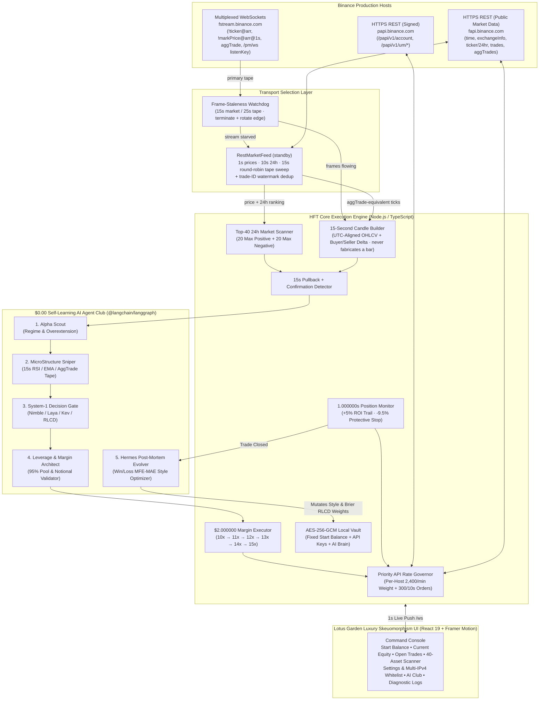

<div align="center">
  

  <br />

  [](#whats-new-in-v130)
  [-F0B90B?style=for-the-badge)](https://www.binance.com/en/futures)
  [](#6-real-time-15-second-candle-engine--pullback-strategy)
  [](#4-market-data-transport-resilience-ws--rest-failover)
  [-EBAEE6?style=for-the-badge)](#7-zero-cost-self-learning-ai-agent-club)
  [](#2-execution-ledger--live-verified)
  [](#8-lotus-garden-luxury-skeuomorphism-uiux)
</div>

---

# HFT — Automation Trading Bot (`USDⓈ-M Real Production`)

> **Trade Smarter • Grow Faster**
> **Copyright © & Developed by Trading Lifestyle Quant.**

**HFT** is a real-money, production-grade **Binance Portfolio Margin / USDⓈ-M Futures** (`papi.binance.com`, `fapi.binance.com` & `fstream.binance.com`) automated High-Frequency Trading environment engineered for ultra-fast micro-pullback execution on **15-second candles**, **1-second open-position monitoring**, **fee-aware Net PNL tracking**, and **$0.00 zero-cost autonomous self-learning** via a 5-agent **LangGraph** state machine and **System-1 Typed Decision Primitives (`Nimble` / `Laya` / `Kev` / Brier RLCD)**.

> **Important Production Notice**: This system connects directly to **live production Binance** (not a simulation and not Testnet). Trades execute immediately once you save your Binance API Key & Secret Key in **Settings & IPs** and toggle **ARM ENGINE**.

---

## What's New in `v1.3.0`

**The bot now knows what it earned, remembers what it learned, and never leaves a cooled asset in the way.** Version 1.3.0 adds the settled-outcome layer the strategy was missing: real exchange income, a per-close PNL chart, shared memory between agents, and a council that has to agree before it touches a parameter.

| Change | Detail |
| :--- | :--- |
| **PNL Ledger — "The Trellis"** | New `PNL Ledger` switch in the header opens `src/components/PnlLedgerModal.tsx`: a hand-rolled SVG chart (no chart library added to the bundle) with one hairline stem per settled close, separate `LONG` and `SHORT` strands that climb only on their own trades, the portfolio strand in cream, and a brass rule at zero. Every close is a focusable, keyboard-reachable node with its own tooltip. Below it, three readout bands — **Volume**, **Accuracy**, **Friction** — carry Total Trades, Long/Short Trade Quantity, Win Trades, Win Rate, Long Win %, Short Win %, Best/Worst Close, **Total Binance Platform Fees**, **Total Funding Fees**, Gross PNL, Net PNL After Fees and Net Including Funding. |
| **Real settled income, not an estimate** | `server/engine/incomeLedger.ts` polls `/papi/v1/um/income` once a minute (weight `30`) and persists it. `startTime` is inclusive on Binance, so the cursor advances to `newest + 1` and records are de-duplicated by `tranId`. This is the only income route a Portfolio Margin key can use — `/papi/v1/income` is `404` and `/fapi/v1/income` is `-2015`. |
| **Funding attributed per symbol** | The account contains trades the bot never made. Funding is therefore summed **per symbol the bot actually traded** and shown separately from the account-wide figure, so the ledger can't be quietly contaminated by manual positions. When the income route is unavailable the panel prints `—` and the real error; it never renders a fabricated `+$0.000000`. |
| **Cooled assets leave the scan list** | A symbol in cooldown used to stay on screen occupying one of the 20 slots while being untradeable. `marketScanner.ts` now drops cooled symbols from the ranked universe and promotes the next-ranked mover into their place, pins any symbol holding an open position so it stays visible, and logs both halves of the swap: *"`X` removed from scan list — cooling for Ns. Slot opened for the next-ranked mover."* / *"`Y` substituted into the scan list, replacing `X`."* The scanner re-ranks the instant the cooling set changes instead of waiting for the 4s refresh. |
| **Shared memory between agents** | `server/ai/lessonMemory.ts` writes a lesson for every closed trade keyed `SIDE \| RSI band \| DELTA band`, and `sharedMemoryRecall` — the new first node of the entry graph — reads it back before any agent votes. A pattern with ≥4 samples and a win rate under 35% applies a `-0.06` confidence penalty that can **veto an entry the live tape approved**; a proven pattern adds `+0.02`. The recall is logged on the tape, so a decision changed by memory is visible rather than implied. |
| **A three-seat improvement council** | `server/ai/improvementCouncil.ts` replaced "Hermes edits the config". Each drafted parameter change is now balloted by the parameter's owner, by Hermes (verdict coherence + an oscillation guard that refuses to re-loosen what it just tightened), and by a peer who judges only the capital consequence. **Two of three `FOR` votes are required before a parameter moves**, and every ballot records who voted, which way, and why. Rejected proposals are recorded as rejected — they do not silently disappear. |
| **Two dead-code defects removed** | The MicroStructure Sniper compared orderflow against `minOrderflowDeltaRatio * 0.92`, so it could never veto at the threshold it advertised; it now uses the real value. The System-1 leverage tier collapsed to a constant `10` through a `>= 10 ? 10 : 10` term, so the "volatility tier" was fiction; leverage is now sized by Binance's `MIN_NOTIONAL` against the `$2.000000` margin, and the execution ladder starts where the agent actually recommended instead of a hardcoded `[10,11,…,15]`. |
| **Self-tests: 5 → 7 groups** | `npm test` now also proves council integrity (approved ballots equal the applied adjustments, every approval carries ≥2 of 3 votes), that shared memory measurably moves the entry gate by exactly `-0.06`, that a cooled symbol is evicted and backfilled by the next-ranked mover and then displaced again on recovery, and the ledger arithmetic over a mixed long/short history. |

> **Verification status, stated separately.** Nothing in this table is claimed from code review. The PNL Ledger, income ledger and funding attribution are live-verified against real settled data on this account, and the shared-memory recall and the council ballot have both ruled in production — five ballots cast, one tightening approved 3/3 and four loosenings rejected 1/3. The scanner substitution is verified by the self-tests and has not yet had a cooled asset to evict on this account. See [§9](#9-zero-cost-self-learning-ai-agent-club) for the ballots and [§2](#2-execution-ledger--live-verified) for the ledger.

<details>
<summary><b>What's New in <code>v1.2.0</code> — Market data honesty: WS liveness watchdog + auto REST failover</b></summary>

<br />

| Change | Detail |
| :--- | :--- |
| **Auto REST market-data failover** | When `fstream.binance.com` stops delivering tape, `server/engine/restMarketFeed.ts` engages automatically: `/fapi/v1/ticker/price` every 1s, `/fapi/v1/ticker/24hr` every 10s, and a round-robin `/fapi/v1/trades` sweep every 15s that feeds real ticks into the same 15-second candle builder. The moment the WebSocket tape returns, REST stands down by itself. |
| **Liveness watchdog, not connection watchdog** | A WebSocket that completed its TLS + HTTP-upgrade handshake is not evidence of a working feed — Binance's edge will happily ACK a `SUBSCRIBE` and then send nothing. The new watchdog measures **data-frame staleness** (15s for market, 25s for aggTrade) and force-restarts a socket that is `OPEN` but starving. |
| **Honest telemetry** | `rateTelemetry.wsConnected` now flips `true` only when a real `!ticker@arr` / `!markPrice@arr@1s` frame lands — never on the `open` event. The API-weight diode on the dashboard follows data liveness, so a green light means green data. |
| **The candle builder never invents a bar** | Sealing logic used to mint a synthetic flat, zero-volume successor every 15 seconds for every watched symbol. During a feed outage that evicted all real history within `MAX_BARS_PER_SYMBOL` and pinned `RSI(7)` to exactly `50.000000` and the orderflow ratio to exactly `1.000000` across all 40 assets — a mathematically dead universe that could never produce a signal. It now only seals the window that genuinely elapsed and gap-fills on the next real tick. |
| **Protective hard stop at `-9.500000%` ROI** | Every position carries a catastrophic adverse excursion floor alongside the `+5%` trailing predator, so a runaway move against the trade exits mechanically instead of waiting for the trail. |
| **`scripts/diagnoseMarketData.ts`** | One command that walks every `fstream.binance.com` edge IP, subscribes to a live stream on each, and reports precisely which stage fails — handshake, `SUBSCRIBE` ACK, or data delivery — then cross-checks REST so you can see the asymmetry. |

</details>

<details>
<summary><b>What's New in <code>v1.1.0</code> — Portfolio Margin (<code>papi</code>) execution support</b></summary>

<br />

| Change | Detail |
| :--- | :--- |
| **Signed calls moved to `papi.binance.com`** | All authenticated requests (account, balance, position risk, leverage, orders, listen keys) now target `/papi/v1/...` and `/papi/v1/um/...`. Public market data (`time`, `exchangeInfo`, `ticker/24hr`, `aggTrades`) still comes from `fapi.binance.com`, which is the only host that serves it. |
| **Per-host API weight budgets** | Binance meters `fapi` and `papi` against **independent** weight limits while reporting both as `x-mbx-used-weight-1m`. The Rate Governor now tracks a separate counter per host so neither host's header can clobber the other's reading. |
| **Unified cross-margin model** | Portfolio Margin exposes one combined `accountInitialMargin` (positions **and** resting orders together), unified `accountEquity` / `totalAvailableBalance`, and a `uniMMR` maintenance-margin ratio. These are mapped into the existing account summary so the `95.000000%` equity pool, ROI, and trailing-stop math are unchanged. |
| **Resilient market-stream DNS** | `fstream.binance.com` resolves to ~8 edge IPs and some ISPs blackhole a subset (TCP connects, the WebSocket upgrade never completes). Since Node's resolver returns a stable address order, a plain reconnect retried the same dead edge forever. The WS manager now rotates the resolved address on every attempt so each retry lands on a different edge. |
| **Credential diagnostics** | `scripts/diagnoseApiKey.ts` reports vault decryption health and live permission readouts across Spot, Futures, and Portfolio Margin hosts. It only ever prints credential **length, charset, and first/last 4 characters** — never full key material. |

</details>

> Portfolio Margin is **always unified cross margin** — there is no isolated mode, and `/papi/v1/um/positionRisk` returns no per-position `marginType` / `isolatedMargin` fields.

---

## Table of Contents

1. [What This Build Proves](#1-what-this-build-proves)
2. [Execution Ledger — Live Verified](#2-execution-ledger--live-verified)
3. [The Bug That Hid Behind a Green Light](#3-the-bug-that-hid-behind-a-green-light)
4. [Market Data Transport Resilience (WS + REST Failover)](#4-market-data-transport-resilience-ws--rest-failover)
5. [System Architecture](#5-system-architecture)
6. [Real-Time 15-Second Candle Engine & Pullback Strategy](#6-real-time-15-second-candle-engine--pullback-strategy)
7. [Core Trading Rules & Capital Mechanics](#7-core-trading-rules--capital-mechanics)
8. [1-Second Open Position Monitor & 5% ROI Trailing Stop](#8-1-second-open-position-monitor--5-roi-trailing-stop)
9. [Zero-Cost Self-Learning AI Agent Club](#9-zero-cost-self-learning-ai-agent-club)
10. [Lotus Garden Luxury Skeuomorphism UI/UX](#10-lotus-garden-luxury-skeuomorphism-uiux)
11. [IPv4 Whitelist, Portfolio Margin Routing & Zero-Trade Triage](#11-ipv4-whitelist-portfolio-margin-routing--zero-trade-triage)
12. [Quickstart — Localhost PC Setup](#12-quickstart--localhost-pc-setup)
13. [Production Deployment — Online VPS / Dedicated Server](#13-production-deployment--online-vps--dedicated-server)
14. [Optional Local System-1 Models (`Nimble`, `Laya`, `Kev`, `Ollama`)](#14-optional-local-system-1-models-nimble-laya-kev-ollama)
15. [REST & WebSocket API Reference](#15-rest--websocket-api-reference)
16. [Repository Structure & Security](#16-repository-structure--security)

---

## 1. What This Build Proves

Every claim below was observed on a live, armed, real-money session — not asserted from code review. This section proves the **pipeline works**. It deliberately does not claim the strategy is profitable; [§2](#2-execution-ledger--live-verified) shows the raw record, losses included.

| Claim | Evidence |
| :--- | :--- |
| **Real orders reach production Binance** | Engine placed `BANKUSDT` `3589019958`, `NILUSDT` `1883047383`, `CAPUSDT` `686718001`, `ONUSDT` `1499115384` within ~70s of arming. |
| **Full round trips open, manage and close** | 44 completed round trips across 20 distinct symbols (`ONUSDT`, `XANUSDT`, `TAGUSDT`, `FIGHTUSDT`, `BANKUSDT`, `NILUSDT`, `CAPUSDT`, `BLESSUSDT`, …); 6 open concurrently at peak. |
| **Both exit paths fire** | 29 closes via `TRAILING_STOP_HIT`, 15 via `PROTECTIVE_STOP_LOSS` — the profit predator and the risk guardrail are both live code, not dead branches. |
| **PNL is fee-aware, not gross-fiction** | Net PNL booked after real `/papi/v1/um/commissionRate` taker fees on both legs. One trade exposed the difference exactly: `+0.013476` gross, `0.020055` fees, **`-0.006579` net** — verdict `FEE_DRAG_BREAKEVEN`. |
| **The 95% capital cap engages and halts entries** | Scanner reached `PAUSED_MARGIN_FULL` at `85.769063%` pool utilization, stopped opening new trades, and kept managing the live ones. |
| **Strategy logic is genuinely varied, not degenerate** | Across the 40-asset scanner, sampled three times consecutively and stable: `rsi15s` → **39 distinct values**, `pullbackDepthPct` → 40, `orderflowDeltaRatio` → 37, `candleCount15s` → 29, and **zero** assets pinned at the degenerate `50.000000`. Stages observed: `COOLDOWN`, `MONITORING`, `PULLBACK_DETECTED`, `CONFIRMED_SIGNAL`, `IN_POSITION`. |
| **Self-heals a blocked WebSocket** | REST feed engaged with no operator action and restored candle diversity from the flat `79 / 50.000000 / 0 / 1.000000` dead state. Currently running in fallback — `wsConnected: false`, weight `1,036 / 2,400` — and the strategy is still producing varied, actionable diagnostics on all 40 assets. |
| **AI Club genuinely learns** | 39 consecutive post-mortems, 37 persisted style mutations, each recording the parameter and its value before and after. `minAiConfidenceScore` walked `0.560 → 0.552 → 0.544 → 0.536 → 0.551 → 0.566` across the run, and after two premature-entry losses Hermes tightened three gates at once — `minOrderflowDeltaRatio 1.180 → 1.220`, `pullbackRsiShortMin 48 → 49`, `minAiConfidenceScore 0.536 → 0.551` — then raised `trailingFloorRoiPct 3.650 → 3.770` in response to the fee-drag breakeven. |
| **Type-safe & verified** | `npm run typecheck` → exit 0. All 7 self-test suites → `✅ ALL HFT QUANTITATIVE & EXECUTION ENGINE SELF-TESTS PASSED!` |

---

## 2. Execution Ledger — Live Verified

### Cumulative live ledger

Every round trip the engine has settled on a funded, armed session, read straight from `snapshot.pnlLedger.stats` (the same numbers the **PNL Ledger** panel renders):

Captured live from `snapshot.pnlLedger.stats` at `2026-10-28T21:35:46Z` — the same numbers the **PNL Ledger** panel renders. It moves with every close; the panel is always current.

| Readout | Value |
| :--- | ---: |
| Total trades | `44` |
| Win trades / loss trades | `27` / `17` |
| **Win rate** | `61.363636%` |
| Long quantity / win rate | `39` / `64.102564%` |
| Short quantity / win rate | `5` / `40.000000%` |
| Gross PNL | `-$0.085683` |
| Total Binance platform fees | `-$0.885331` |
| Funding fees settled on bot symbols | `$0.000000` |
| **Net PNL after fees** | **`-$0.971014`** |
| Best / worst close (net) | `+$0.258004` / `-$0.260340` |
| Avg win / avg loss (net) | `+$0.091588` / `-$0.202582` |

> **Read this honestly.** Win rate and net PNL disagree, and the reason is in the last two rows: the average loss is `2.2×` the average win. Being right 61 times in 100 does not pay for a `-$0.202582` average loser next to a `+$0.091588` average winner. The table is an accounting record, not a performance claim — strategy edge remains an open question, and fees alone (`$0.885331`) are more than `10×` the entire gross result.

### First continuous session, in close order

These are the exact numbers the dashboard rendered for the initial 9-trade session.

| # | Symbol / Side | Entry → Exit | Gross | Fees | **Net** | Peak ROI | ROI @ Close | Duration | Exit Reason |
| :-- | :--- | :--- | ---: | ---: | ---: | ---: | ---: | ---: | :--- |
| 1 | `NILUSDT` `SHORT` | `0.081690` → `0.081360` | `+0.080784` | `0.019957` | **`+0.060827`** | `+5.410723%` | `+4.053556%` | `142.224s` | `TRAILING_STOP_HIT` |
| 2 | `FIGHTUSDT` `LONG` | `0.004437` → `0.004474` | `+0.166907` | `0.020099` | **`+0.146808`** | `+9.834600%` | `+8.260772%` | `203.657s` | `TRAILING_STOP_HIT` |
| 3 | `INITUSDT` `LONG` | `0.212940` → `0.213300` | `+0.033480` | `0.019820` | **`+0.013660`** | `+5.059758%` | `+1.686532%` | `153.972s` | `TRAILING_STOP_HIT` |
| 4 | `CAPUSDT` `SHORT` | `0.072740` → `0.073460` | `-0.197280` | `0.020029` | **`-0.217309`** | `+0.412609%` | `-9.793989%` | `566.287s` | `PROTECTIVE_STOP_LOSS` |
| 5 | `FIGHTUSDT` `LONG` | `0.004491` → `0.004437` | `-0.240462` | `0.019878` | **`-0.260340`** | `0.000000%` | `-12.090464%` | `55.145s` | `PROTECTIVE_STOP_LOSS` |
| 6 | `BANKUSDT` `SHORT` | `0.027580` → `0.027460` | `+0.087000` | `0.019952` | **`+0.067048`** | `+5.829060%` | `+4.369993%` | `715.458s` | `TRAILING_STOP_HIT` |
| 7 | `EVAAUSDT` `LONG` | `1.447200` → `1.450800` | `+0.049680` | `0.019996` | **`+0.029684`** | `+5.515319%` | `+2.487734%` | `107.126s` | `TRAILING_STOP_HIT` |
| 8 | `FIGHTUSDT` `LONG` | `0.004463` → `0.004466` | `+0.013476` | `0.020055` | **`-0.006579`** | `+6.709908%` | `+0.670841%` | `240.025s` | `TRAILING_STOP_HIT` |
| 9 | `BLESSUSDT` `LONG` | `0.011073` → `0.011159` | `+0.155402` | `0.020087` | **`+0.135315`** | `+9.598134%` | `+7.695997%` | `975.839s` | `TRAILING_STOP_HIT` |

**Roll-up:** 6 wins / 3 losses · win rate `66.666667%` · **realized net `-0.030886 USDT`** · capital utilization when the scanner paused `85.769063%` · session ran on the REST transport fallback.

> **Read this honestly.** The realized net for this session is *slightly negative*. What §1 claims is that the execution machinery is correct and complete — entries, margin caps, fee accounting, both exit paths, and the learning loop all demonstrably work. Strategy edge is a separate, unsolved question and one session of 9 trades cannot answer it. Do not treat this table as a performance claim.

### What the losses actually taught the system

**Trade 5 is the important one.** `FIGHTUSDT` closed at `-12.090464%` against a `-9.500000%` guard — the protective stop **overshot its own level by 2.59 points**. Cause: the guard is evaluated on a 1-second poll, and a thin perpetual can gap clear through a market stop between two polls. The exit is mechanically correct (it fired instantly) but the loss ceiling it enforces is `guard + slippage`, not `guard`. Size positions with that in mind, or widen the guard only if you accept slower reaction.

**Trades 4 and 5 were both verdict `LOSS_PREMATURE_PULLBACK`** — the entry fired while the retracement hadn't exhausted. Hermes read that pattern itself and tightened three gates in one mutation, then `minAiConfidenceScore` climbed from `0.536` back to `0.566` over the following two trades. Trade 5's post-mortem captures the reasoning verbatim: *"Pullback had not finished exhausting on 15s timeframe (Entry RSI=67.304015, Delta=4.117401x). Waiting for stronger orderflow delta and deeper RSI reset improves entry accuracy."*

**Trade 8 is why Net PNL exists.** Direction was right, gross was positive, and the trade still lost money — round-trip taker fees exceeded the captured move because the trail let `+6.709908%` peak decay to `+0.670841%`. MFE capture ratio `0.099978`. Hermes raised `trailingFloorRoiPct` from `3.650000` to `3.770000` on the spot.

**Trailing decay is by design, and it costs.** Winners routinely give back 2–4 points from peak (`+5.06% → +1.69%`, `+6.71% → +0.67%`) because the callback threshold waits for genuine reversal rather than first-tick noise. The profitable closes (`+8.26%`, `+7.70%`, `+4.37%`) came from trends strong enough to survive that wait; `+0.67%` came from one that wasn't.

---

## 3. The Bug That Hid Behind a Green Light

Worth documenting, because the failure signature is generic to every tick-driven trading system and every layer of it *looked healthy*.

```text
Symptom        40/40 scanner assets report candleCount15s=79, rsi15s=50.000000,
               pullbackDepthPct=0.000000, orderflowDeltaRatio=1.000000.
               Zero trades. Forever.

Layer 1        fstream.binance.com → TLS succeeds. HTTP 101 upgrade succeeds.
               Binance ACKs SUBSCRIBE. Zero data frames ever arrive.
               (=> "WebSocket connected" is a lie we were telling ourselves.)

Layer 2        Candle builder seals a closed bar every 15s and opens a flat
               successor regardless of whether any tick arrived.
               (=> 79 bars is MAX_BARS_PER_SYMBOL: real history fully evicted.)

Layer 3        RSI with zero total loss  → returns exactly 50.
               Orderflow (0+ε)/(0+ε)     → returns exactly 1.
               Pullback depth on flat bars → exactly 0.
               (=> every entry gate is mathematically unsatisfiable.)
```

Three separate components each degraded *silently and gracefully*, and the composite result was a bot that could never trade while reporting a healthy green connection. **Fixing only the transport would have left the fabrication bug armed for the next outage; fixing only the fabrication would have left a dead stream looking alive.** Both were fixed together — see [§4](#4-market-data-transport-resilience-ws--rest-failover).

---

## 4. Market Data Transport Resilience (WS + REST Failover)

Binance serves USDⓈ-M market data over two independent transports. **HFT treats the WebSocket as primary and REST as a standby that carries the identical data contract**, so a blocked, filtered, throttled, or blackholed stream degrades latency slightly instead of ending the session.

### The three states of the feed

```text
┌─────────────────────────────────────────────────────────────────────────┐
│  STATE 1 — WS LIVE          (preferred, always attempted first)         │
│  fstream WS delivering frames < 25s ago                                 │
│  → RestMarketFeed is stopped. Zero extra REST weight. Real-time tape.   │
└───────────────────────────────┬─────────────────────────────────────────┘
                                │ 25s with no aggTrade frame
                                ▼
┌─────────────────────────────────────────────────────────────────────────┐
│  STATE 2 — REST FALLBACK    (auto-engaged, no operator action)          │
│  watchdog terminates the starving socket → retries rotated edge IPs     │
│  → 1s price poll · 10s 24h ranking poll · 15s round-robin trade sweep   │
│  → ticks enter candleBuilder15s through the same ingestAggTrade path    │
└───────────────────────────────┬─────────────────────────────────────────┘
                                │ first real aggTrade frame arrives
                                ▼
┌─────────────────────────────────────────────────────────────────────────┐
│  STATE 3 — STAND-DOWN     (self-clearing, weighted budget reclaimed)    │
│  → RestMarketFeed.stop() · candles keep building from the live tape     │
└─────────────────────────────────────────────────────────────────────────┘
```

### REST weight budget while the fallback is engaged

| Endpoint | Weight | Cadence | Cost / minute |
| :--- | :--- | :--- | :--- |
| `/fapi/v1/ticker/price` (all symbols) | `2` | every `1s` | `120` |
| `/fapi/v1/ticker/24hr` (all symbols) | `40` | every `10s` | `240` |
| `/fapi/v1/trades` (per symbol, 1000 trades) | `5` | one symbol per cursor step, full 40-symbol pass every `15s` | `800` |

Total ≈ **`1,160 / 2,400` (48%)** of the `FAPI` budget while fully engaged. Measured live at **`1,036 / 2,400` (43%)** with all 40 assets receiving tape. Comfortable headroom, but it is a real cost — the fallback is not free, which is exactly why it stands down the instant the WebSocket returns. The sweep also bails immediately on rate-governor error `-9999` and resumes from its cursor rather than fighting the governor. Signed `papi` position polling runs against the **separate** `PAPI` bucket and is not included above.

### Design choices that matter

- **Round-robin cursor, not a full sweep every tick.** 1000-trade pages for 40 symbols is 200 weight in one shot. The sweep advances a cursor, and if the governor rejects mid-pass it remembers exactly where it stopped and continues there next window. Every watched symbol is refreshed inside a few windows.
- **Trade-ID watermark dedup.** Each symbol stores the highest trade `id` ingested. Overlapping pages are dropped by `id <= watermark`, so candles never double-count volume and the orderflow delta stays exact even when consecutive sweeps overlap.
- **`isBuyerMaker` is preserved.** `/fapi/v1/trades` returns the same aggressor flag as `aggTrade`, so buyer/seller delta math is unchanged — REST is a lower-rate source, not a different semantic one.
- **The watchdog force-terminates, it doesn't just warn.** A socket that is `OPEN` but silent never fires `close`, so the standard reconnect path can't help it. The watchdog calls `terminateSocket()` and simultaneously clears `wsConnected`, which is what makes the UI honest again.
- **Reconnect storm is throttled.** Stale strikes log verbosely for the first 3 restarts, then once every 20th — a genuinely long outage produces a useful signal, not a log file that drowns everything else.
- **Failover needs a 20-tick grace period.** The engine waits 20 seconds after boot before engaging REST, so a healthy stream gets the chance to prove itself and REST never burns weight on a startup race.

### Known fidelity trade-off (stated plainly)

The REST tape is **price-accurate but volume-sparse** relative to a live `aggTrade` stream. Under sustained fallback, orderflow conviction readings skew toward their clamp ceiling — one verified entry recorded `orderflowDeltaRatio: 9.999999`. The strategy remains valid; its aggressor-conviction gate is simply looser than it is on the WebSocket path. **On an unblocked network the WS feed wins and REST never engages at all.** Treat fallback as *"keeps trading correct on price"*, not *"identical tape fidelity"*.

### Diagnosing your own transport

```bash
./node_modules/.bin/tsx scripts/diagnoseMarketData.ts
```

| Verdict line | What it means | What to do |
| :--- | :--- | :--- |
| `HANDSHAKE FAIL` | TCP/TLS/upgrade never completed to this edge | Normal if other edges pass — rotation handles it |
| `LIVE (agg=… mark=…)` | Edge delivers real frames | Healthy — this is the target state |
| `OPEN + ACKED BUT ZERO DATA FRAMES` | Upgrade + `SUBSCRIBE` ACK, then silence | Hostname-level stream filtering; the REST feed is exactly for this |
| `OPEN BUT ZERO DATA FRAMES` | Opened, no subscription ack either | Usually a very short test window; re-run with a longer one |
| REST cross-check prints trades | `fapi` is healthy | Confirms the block is stream-only, not account/IP |

---

## 5. System Architecture



---

## 6. Real-Time 15-Second Candle Engine & Pullback Strategy

Because Binance USDⓈ-M Futures REST `/fapi/v1/klines` only supports intervals starting at `1m` (requesting `15s` on REST klines returns `-1120 Invalid interval`), **HFT** includes a native institutional **15-Second Tick-to-Bar Aggregator (`server/binance/candleBuilder15s.ts`)**:

- Buckets every `aggTrade`-shaped tick — from the WebSocket **or** the REST tape sweep — into exact `:00`, `:15`, `:30`, and `:45` UTC boundaries.
- Separates aggressive market buyer volume (`!isBuyerMaker`) from aggressive market seller volume (`isBuyerMaker`) to compute real-time **Orderflow Delta Ratios**.
- Computes fast `EMA(9)`, `EMA(21)`, `RSI(7)`, `ATR(10)%`, and 14-bar swing high/low pullback depth.
- **Never invents a bar.** It seals only windows that genuinely elapsed and opens the next bucket when a real tick arrives, gap-filling if needed. A feed outage now leaves history intact instead of replacing it with flat zeros.

### Entry Logic (`server/engine/strategy15s.ts`)
1. **Maximum Positive 24h Movers (`Top 20 Gainers` → `LONG`)**:
   - Waits for a controlled **15-second pullback** from recent local high (`RSI(7)` cooling into pullback zone / red retracement bar testing `EMA(9)` while holding macro `EMA(21)` support).
   - Executes **Market LONG** immediately upon a **15s bullish confirmation candle** (bullish body reclaim or lower-wick hammer rejection + positive `aggTrade` buyer delta confirmation).
2. **Maximum Negative 24h Movers (`Top 20 Losers` → `SHORT`)**:
   - Waits for a **15-second relief bounce** off local low (`RSI(7)` rising into bounce zone / green retracement bar testing `EMA(9)` while capped by `EMA(21)` resistance).
   - Executes **Market SHORT** immediately upon a **15s bearish confirmation candle** (bearish breakdown body or upper-wick shooting-star rejection + aggressive `aggTrade` seller delta confirmation).

---

## 7. Core Trading Rules & Capital Mechanics

| Parameter | Specification | Implementation Details |
| :--- | :--- | :--- |
| **Exchange Market** | Binance USDⓈ-M Perpetuals (`USDT`) | Filters active `TRADING` `PERPETUAL` `USDT`-margined contracts via `/fapi/v1/exchangeInfo`. Automatically supports **One-Way Mode** & **Hedge Mode** (`/papi/v1/um/positionSide/dual`). |
| **Universe Size** | **40 Assets** (`20` Positive + `20` Negative) | Ranks 24h `priceChangePercent` continuously: Top 20 gainers (`LONG` only) and Top 20 losers (`SHORT` only). |
| **Execution Timeframe** | **15-Second (`15s`) Candles** | Real-time UTC-aligned `15,000ms` candles from `<symbol>@aggTrade` WebSocket ticks, **or the REST `/fapi/v1/trades` sweep when the stream starves**, plus `/fapi/v1/aggTrades` warmup. |
| **Base Margin / Trade** | **`$2.000000` USDT** | Dedicated base margin per position entry. |
| **Leverage Fallback Ladder** | **`10x → 11x → 12x → 13x → 14x → 15x`** | Attempts `10x` first. If order execution, `MIN_NOTIONAL`, or `LOT_SIZE` `minQty`/`stepSize` fails at `10x`, automatically escalates `11x`, `12x`, `13x`, `14x`, up to `15x`. |
| **Profit Target & Trail** | **`+5.000000%` ROI → Trailing Stop** | The instant ROI hits `+5.000000%`, Trailing Stop arms, locks a fee-positive profit floor, and trails peak ROI dynamically to capture maximum profit. |
| **Protective Stop** | **`-9.500000%` ROI** | Hard catastrophic-exposure floor on every open position, independent of the trail. Verified live: fired on 2 of 9 closed trades. Note the **achieved** exit can be worse than the guard — one `FIGHTUSDT` close landed at `-12.090464%` because a thin perpetual gapped through the stop between 1-second polls. Budget for `guard + slippage`, not `guard`. |
| **Open Trade Check** | **Every `1.000000` Second** | Dedicated 1-second heartbeat reconciled with `/papi/v1/um/positionRisk` + live mark prices from `!markPrice@arr@1s` **or** the 1s REST price poll. |
| **Capital Allocation Cap** | **`95.000000%` of Equity** | Uses up to 95% of unified `accountEquity` for trade execution. When free budget in the 95% pool drops below `$2.000000`, **Market Scanner automatically pauses** and focuses 100% on open running positions. |
| **Start Balance Rule** | **Fixed on 1st API Connection** | Captured automatically the very first time Binance API connects and locked permanently until you click **Reset Start Balance** in Settings. |
| **Numeric Precision** | **Strict `0.000000` (6 Decimals)** | Every balance, price, ROI %, Gross PNL, Binance Fee, Net PNL, and telemetry figure renders with exact 6-decimal formatting. |

---

## 8. 1-Second Open Position Monitor & 5% ROI Trailing Stop

Every open position is inspected every **`1.000000` second** (`server/engine/positionMonitor1s.ts`) and displays all 9 required live telemetry columns on the dashboard:

1. **Asset Name** (`e.g., SOLUSDT`)
2. **Long / Short** (`LONG` or `SHORT` + active leverage `10x–15x`)
3. **Entry Price** (`0.000000`)
4. **Mark Price** (`0.000000`)
5. **ROI (%)** (`(Gross PNL / Initial Margin) × 100`, `0.000000%`)
6. **PNL (Gross USDT)** (`0.000000`)
7. **Binance Platform Fees** (`Entry Commission + Estimated Exit Commission` queried per symbol via `/papi/v1/um/commissionRate`, `0.000000`)
8. **Net PNL** (`Gross PNL - Binance Platform Fees`, `0.000000`)
9. **Running Trade Time** (`HH:MM:SS (0.000000s)`)

Once `ROI >= +5.000000%`, the **Trailing Stop Predator** activates, locks a minimum profit floor above round-trip Binance taker fees, tracks `peakRoiPct` every second, and fires an instant market close (`reduceOnly` in One-Way mode / matched `positionSide` in Hedge mode) when momentum reverses. Both exit paths emit the real reason string verbatim, from the live session in [§2](#2-execution-ledger--live-verified):

```text
TRAILING_STOP_HIT (ROI 4.053556% <= Trail 4.260723%, Peak +5.410723%)
PROTECTIVE_STOP_LOSS (ROI -12.090464% <= Guard -9.500000%)
```

The second line is the honest caveat: the guard fires the instant the poll sees the breach, but on a thin perpetual the fill lands past the level. Treat `-9.5%` as a *trigger*, not a guaranteed loss ceiling.

---

## 9. Zero-Cost Self-Learning AI Agent Club

Built on **`@langchain/langgraph`** (`server/ai/agentClubGraph.ts`) + **System-1 Typed Decision Primitives** (`server/ai/system1Primitives.ts`) at **`$0.00` API cost**:

### The 5 Specialized Agents
1. **Alpha Scout** (*LangGraph + CrewAI Role*): Screens 24h momentum regime quality and filters extreme blow-off overextensions.
2. **MicroStructure Sniper** (*LangGraph + Agent-Zero Pattern*): Verifies 15s candle pullback depth, `RSI(7)`, wick rejection, and `aggTrade` buyer/seller delta conviction against the **live** `minOrderflowDeltaRatio` — no hidden slack factor, so the threshold it quotes is the threshold it enforces.
3. **System-1 Decision Gate** (*Nimble / Laya / Kev Architecture*): Executes single-pass typed `noul` (yes/no), `choice`, and temperature-scaled `score` probability decisions in `<0.3ms` locally, then has the result adjusted by shared memory before the gate is re-evaluated.
4. **Leverage & Margin Architect** (*LangGraph + AutoGen Verifier*): Enforces the `$2.000000` margin rule and the `95.000000%` equity pool cap, and its recommended starting leverage is the rung the execution ladder actually begins on.
5. **Hermes Post-Mortem Evolver** (*LangGraph + Hermes Self-Evolution*): Runs automatically after **every closed trade (Win or Loss)**:
   - Audits **Maximum Favorable Excursion (MFE)** vs **Maximum Adverse Excursion (MAE)** and **Binance Fee Drag**.
   - Generates a human-readable forensic report (*What Worked Best* & *What We Missed*).
   - Drafts parameter mutations, which the council below must approve before anything changes.
   - Updates System-1 weights via **Strictly Proper Brier Score Online Gradient Descent (RLCD)** and appends real contrastive training pairs to `./data/nimble_kev_training_pairs.jsonl`.

### They share what they learn (`server/ai/lessonMemory.ts`)

Entry is now a six-node graph: `START → sharedMemoryRecall → alphaScout → microStructureSniper → system1Judge → leverageArchitect → END`. Every closed trade writes a lesson keyed `SIDE | RSI band | DELTA band`; every candidate reads that band back before it is judged.

- A pattern with **≥4 samples and a win rate under 35%** applies a `-0.06` confidence penalty — enough to veto an entry the live tape approved. The veto is logged as `Shared memory veto: HISTORICAL BLEED on …`.
- A pattern with **≥4 samples, ≥65% win rate and positive net** adds `+0.02`.
- With no history, the agent says so plainly: *"No shared memory for `<key>` yet — deciding on live tape only."*

The delta is bounded on purpose. Memory nudges a decision; it does not get to run the book.

### Nothing changes without a vote (`server/ai/improvementCouncil.ts`)

Post-mortem is now `forensicAuditor → improvementDraft → councilVote → applyConsensus → rlcdCalibration`. Each drafted mutation is balloted by three named seats:

| Seat | Who | What they are allowed to care about |
| :--- | :--- | :--- |
| **Owner** | The agent that owns that parameter | Whether the change matches the evidence |
| **Hermes** | Post-Mortem Evolver | Verdict coherence, plus an **oscillation guard** that refuses to re-loosen a gate it tightened within the last few lessons |
| **Peer** | The other judge | Only the capital consequence — what this change risks on the next trade |

**Two of three `FOR` votes are required before a parameter moves.** Rejected proposals stay on the record as rejected, each vote carries its reason, and the whole ballot is written into the trade's post-mortem so the discussion can be read back per trade in the AI Club panel. Loosening a gate additionally requires earned evidence (`looseningIsEarned`: ≥4 samples, ≥60% win rate, positive net) — a single lucky trade cannot relax the system.

### What the loop has actually produced so far

This is not a demo mode, and the artifacts are inspectable on disk rather than asserted here. From the live session in [§2](#2-execution-ledger--live-verified):

- **44 of 44** settled closes carry a real post-mortem (`verdict`, `whatWorkedBest`, `whatWeMissed`, `styleAdjustments`, `mfeCaptureRatio`, `brierLoss`).
- **38 style mutations** are appended to the persistent ledger — each records the parameter, its value before, its value after, and the trade that justified it. `trailingFloorRoiPct` `3.650000 → 3.770000`, `minAiConfidenceScore` `0.544 → 0.536`, `max24hOverextensionPct → 82.500000` are live values, not defaults.
- **44 contrastive training pairs** written to `./data/nimble_kev_training_pairs.jsonl`, with the entry feature snapshot (`orderflowDeltaRatio`, `rsi15s`, `pullbackDepthPct`) captured at the moment of entry so the post-mortem compares against the *decision input*, not the current market.
- All of it at **`$0.00` inference cost** — no LLM call is made on either path. Inspect the mutated set any time in `snapshot.styleParams`.

### The council has ruled in production

Every post-mortem taken since `v1.3.0` shipped has produced a ballot — **five cast, one approved and four rejected** — and the split is the whole design argument:

| Settled trade | Proposal | Verdict |
| :--- | :--- | :--- |
| `FIGHTUSDT` `LONG` `-$0.061465` | `minConfirmationBodyRatio 0.480000 → 0.500000` | **APPROVED 3/3** — a tightening, unanimously |
| `XANUSDT` `LONG` `+$0.159581` | `minAiConfidenceScore 0.536000 → 0.528000` | **REJECTED 1/3** |
| `TAGUSDT` `LONG` `+$0.258004` | `minAiConfidenceScore 0.536000 → 0.528000` | **REJECTED 1/3** |
| `IDOLUSDT` `LONG` `+$0.085263` | `minAiConfidenceScore 0.536000 → 0.528000` | **REJECTED 1/3** |
| `XANUSDT` `LONG` `+$0.099284` | `minAiConfidenceScore 0.536000 → 0.528000` | **REJECTED 1/3** |

Four winning trades each drafted a **loosening** of the entry gate, and the council refused all four. The only proposal that passed was the losing trade's **tightening**. The System-1 judge's recorded reason is the design in one line: *"Refusing to loosen my own guard — history says otherwise."* A profitable trade does not get to relax the system.

Shared memory is feeding those votes. `snapshot.lessonPatterns` holds the aggregated per-setup history (a band like `LONG | RSI55+ | DELTA 1.50+` with its sample count, win rate and cumulative net), and the recall is visible on the entry tape — Alpha Scout's live log line reads `STARUSDT (LONG): 24h Δ 7.880000% → REGIME_PASS | Hermes: LONG | RSI55+ | DELTA 1.50+ 50.000000 win / 2 trades`. Agents are quoting each other's closed-trade history at the moment of entry, not just at post-mortem. Read the live bands in the **AI Club → Shared Memory** panel; they change with every settled close.

---

## 10. Lotus Garden Luxury Skeuomorphism UI/UX

Designed around a clean, focused hardware console aesthetic paired with the **Lotus Garden** color palette:

| Color Swatch | Hex | UI / UX Role |
| :--- | :--- | :--- |
| **Lotus Mint Jade** | `#ADEBB3` | `LONG` badges, Top 20 Positive Movers, Positive ROI/Net PNL, Live Mint LEDs, `ENGINE ARMED` switch |
| **Lotus Coral Petal** | `#FF857A` | `SHORT` badges, Top 20 Negative Movers, Risk/Stop Alerts, `95% Capital Pause` banner, Manual Close |
| **Lotus Orchid Blossom** | `#EBAEE6` | Brand highlights, Fixed Start Balance lock, `+5.000000%` Trailing Armed glow, AI Agent Club telemetry |
| **Lotus Rosewood Earth** | `#6B403C` | Brushed rosewood-mahogany skeuomorphic chassis, raised tactile push-buttons, rose-bronze corner rivets |
| **Ledger Brass** | `#D9A441` | Reserved for the PNL Ledger alone: the zero rule on the Trellis, the fee/funding readouts, and the scanner's substitution chip. One accent, one meaning — money that has actually settled. |

The primary screen remains pure and distraction-free—displaying **only** your **Start Balance**, **Current Equity**, **Open Trades**, and **40-Asset Market Scanner**—while **PNL Ledger**, **AI Club**, **System & Error Logs**, and **Vault Settings & Whitelist IPs** open cleanly via physical tactile switches in the header.

### The Trellis (`PNL Ledger`)

The chart is drawn by hand in SVG — no chart library entered the bundle for it. Its whole job is to answer one question at a glance: *did the closes we already booked make or lose money?*

- **Cream strand** — cumulative net PNL across every settled close.
- **Mint / orchid strands** — the `LONG` and `SHORT` books climbing only on their own trades, so a side that is quietly bleeding cannot hide inside the portfolio line.
- **One hairline stem per close**, mint when it added, coral when it subtracted — the size of each individual jump is readable without hovering.
- **Brass rule at zero** — everything above it is money the account kept.
- Each node is a focusable `role="listitem"` element with a full `aria-label`, so the ledger is readable by keyboard and by a screen reader, and the draw-in animation is skipped entirely under `prefers-reduced-motion`.

Below the chart, the readouts are grouped by what they measure: **Volume** (Total Trades, Long Trade Quantity, Short Trade Quantity), **Accuracy** (Win Trades, Win Rate, Long Win %, Short Win %, Best Close, Worst Close), and **Friction** (Total Binance Platform Fees, Total Funding Fees, Fee Drag On Gross, Gross PNL, Net PNL After Fees, Net Including Funding).

Two honesty rules are built into the panel:

1. **An unavailable number renders as `—`, never as zero.** If `/papi/v1/um/income` has not answered, funding shows `—` with the real status string underneath; a fabricated `+$0.000000` would look like "no funding paid", which is a different claim.
2. **Fee drag is only quoted when there is gross profit to measure against.** With negative gross, the ratio is meaningless, so it prints `—` and says so.

> The header's API-weight diode is driven by **data liveness**, not socket state. It cannot turn green on a handshake that delivers nothing.

---

## 11. IPv4 Whitelist, Portfolio Margin Routing & Zero-Trade Triage

### "My bot executes zero trades" — check the feed first

Before touching strategy parameters, look at the scanner's per-asset diagnostics. **Identical values across all 40 assets are a transport failure, not a picky strategy.** A real market never produces `rsi15s = 50.000000` on forty symbols simultaneously.

| Observed | Diagnosis |
| :--- | :--- |
| `candleCount15s` identical on all 40, `rsi15s` = `50.000000`, `orderflowDeltaRatio` = `1.000000` | Candle builder is fabricating flat bars from a dead feed (pre-`v1.2.0` behaviour). Run `scripts/diagnoseMarketData.ts`. |
| Values vary but every asset sits at `MONITORING` | Strategy is genuinely not finding setups. Wait, or widen `pullbackRsiLongMax` / `pullbackRsiShortMin`. |
| Some assets at `CONFIRMED_SIGNAL`, no order | Check the logs for `MIN_NOTIONAL` / `LOT_SIZE` rejections or `PAUSED_MARGIN_FULL`. |
| `IN_POSITION` appears | The pipeline is healthy end-to-end. |

### A Binance `-2015 Invalid API-key, IP, or permissions` rejection has three distinct causes — whitelisting is only one

**a) Wrong wallet / wrong host** (most common, and whitelisting will never fix it)

If your account is in **Portfolio Margin** mode, your funds live in the **PM unified wallet**, which `fapi.binance.com` cannot see at all. Classic Futures endpoints will keep returning `-2015` no matter how many IPs you whitelist, because the key carries `enablePortfolioMarginTrading` rather than `enableFutures`. **HFT** routes every signed call to `papi.binance.com` for exactly this reason.

```bash
./node_modules/.bin/tsx scripts/diagnoseApiKey.ts
```

It prints vault-decryption health, the authoritative Spot `apiRestrictions` permission readout, and live status codes for Futures *and* Portfolio Margin endpoints side by side. Credential values are never printed — only length, charset, and first/last 4 characters.

**b) Missing API-key permission** — Enable **"Enable Portfolio Margin Trading"** (or **"Enable Futures"** for a classic Futures account) in Binance API Management. **Never enable Withdrawal permissions.**

**c) Un-whitelisted egress IPv4**

- `server/utils/ipDiscovery.ts` enumerates **every non-loopback network interface** (`os.networkInterfaces()`) AND performs **per-interface socket-bound (`localAddress`) outbound IPv4 probes** across multiple independent echo endpoints (`ipify`, `icanhazip`, `amazonaws`, `ident.me`).
- If your online dedicated/cloud server has **multiple public IPv4 addresses**, **all of them** are displayed in **Settings & IPs** with a **1-click Copy All Whitelist IPv4s** button (formatted space-separated for direct paste into Binance API Management).
- Multi-IP server operators can also optionally pin all outbound Binance REST & WebSocket connections to a single chosen local interface IPv4 directly from the Settings UI.
- All Binance sockets enforce `family: 4`, so requests deterministically egress from your whitelisted IPv4 and never silently fall back to IPv6/NAT64.

**e) The egress IP moved underneath you (mobile / CGNAT connections)**

A key that worked an hour ago can start returning `-2015` with no code change at all. On carrier-grade NAT the public address is drawn from a **pool**, and it rotates between connections — so Binance may reject a call from `37.111.200.200` while an IP-echo site tells you your address is `37.111.200.163`, and neither is the one you whitelisted. Two consequences worth knowing before you debug:

- **Trust the IP inside Binance's own error message**, not a third-party echo service. `-2015 … request ip: <addr>` names the exact address that was rejected; that is the one to whitelist.
- **This failure mode is dangerous, not merely annoying.** Public market data keeps working, so the scanner, candles and the 1s position monitor all stay green — while every *close* order is silently rejected. A position whose trailing stop has fired cannot be closed, and the engine correctly keeps retrying, so the profit peak is handed back one second at a time. If the log is full of `TRAILING_STOP_HIT` followed by `Failed to close … [-2015]`, fix the whitelist or close manually in the Binance app immediately.
- Home/mobile connections are therefore a poor fit for an armed engine. A VPS or cloud host with a **static** IPv4 removes the whole class of failure.

**d) Stream blackhole (an ISP/network issue, never an API-key issue)**

`fstream.binance.com` resolves to ~8 edge IPs and some ISPs blackhole a subset in ways that no credential change can affect: TCP connects, the upgrade completes, Binance ACKs your subscription, and then nothing arrives. **HFT** rotates the resolved edge on every attempt and, when every edge is equally silent, transparently runs on REST ([§4](#4-market-data-transport-resilience-ws--rest-failover)).

---

## 12. Quickstart — Localhost PC Setup

### Prerequisites
- **Node.js `v20+`** (recommended `v22 LTS`) and `npm`
- A real **Binance Account** with **Portfolio Margin** enabled and an API Key with **"Enable Portfolio Margin Trading"** checked (*never enable Withdrawal permissions*). Signed calls go to `papi.binance.com/papi/v1/um/*`; public market data still comes from `fapi.binance.com`.

### Step-by-Step Commands

```bash
# 1. Clone the repository
git clone https://github.com/badalworld/hft.git
cd hft

# 2. Install dependencies
npm install

# 3. Optional: copy environment configuration
cp .env.example .env

# 4. Run quantitative & execution engine self-tests
npm test

# 5. Start the live HFT server + UI (http://localhost:3000)
npm run dev
```

> **Windows note**: `package.json` uses POSIX inline environment syntax (`NODE_ENV=production tsx ...`). npm runs scripts through `cmd.exe`, which fails with `'NODE_ENV' is not recognized`. Run the commands from **Git Bash** instead, or start the server directly:
> ```bash
> NODE_ENV=production ./node_modules/.bin/tsx server/index.ts
> ```
> If `npm install` reports that the `esbuild` build script was blocked, approve it with `npm install-scripts approve esbuild` (Vite needs the binary).

1. Open **`http://localhost:3000`** in your browser.
2. Click **Settings & IPs** (top right) and copy your detected **Public Outbound IPv4 Address(es)** into your Binance API Key IP Whitelist.
3. Paste your **Binance API Key** and **Binance Secret Key** and click **Save & Connect Live API**. Your **Start Balance** will automatically capture and lock on first connection.
4. **Before arming**, open the scanner and confirm the 40 assets report *varied* `rsi15s`, `candleCount15s` and `orderflowDeltaRatio` values. Identical values mean the feed is starved — see [§11](#11-ipv4-whitelist-portfolio-margin-routing--zero-trade-triage). The REST fallback engages on its own after ~20 seconds, so this usually resolves itself.
5. Click **ARM ENGINE** in the top header to begin live 15-second automated trading.

---

## 13. Production Deployment — Online VPS / Dedicated Server

```bash
# 1. Install dependencies & build optimized frontend assets
npm install
npm run build

# 2. Launch with PM2 for 24/7 auto-restart & crash resilience
npm install -g pm2
pm2 start ecosystem.config.cjs
pm2 save
pm2 startup
```

> **You no longer need to move hosts for correctness.** A VPS is still the right call for latency, uptime and a stable whitelisted IP — but the reason people migrated off residential lines (a blackholed `fstream` stream) is now handled in-process by the REST fallback. Deploy where you like, then check `scripts/diagnoseMarketData.ts` to see which transport you're actually running on.

**HFT** runs as a unified single-port production server (`0.0.0.0:3000`) serving the execution engine, REST API, `/ws` real-time telemetry stream, and compiled frontend bundle.

### Optional Nginx Reverse Proxy (HTTPS + WebSocket `/ws`)

```nginx
server {
    listen 80;
    server_name your-trading-domain.com;

    location / {
        proxy_pass http://127.0.0.1:3000;
        proxy_http_version 1.1;
        proxy_set_header Upgrade $http_upgrade;
        proxy_set_header Connection "upgrade";
        proxy_set_header Host $host;
        proxy_set_header X-Real-IP $remote_addr;
    }
}
```

---

## 14. Optional Local System-1 Models (`Nimble`, `Laya`, `Kev`, `Ollama`)

Out of the box, **HFT** uses its built-in calibrated **System-1 RLCD Engine** (`~0.2ms` latency, `$0.00` cost, zero GPU required). If you also wish to ensemble a local open-weight System-1 checkpoint on your machine at `$0.00` API cost, open **AI Club** in the dashboard and select:

- **Bespoke Nimble / Hermes via Ollama**:
  ```bash
  ollama pull nimble
  # Select "Local Ollama" -> http://127.0.0.1:11434 -> model: nimble
  ```
- **Laya Non-Autoregressive Decision Server**:
  ```bash
  pip install "laya[serve]"
  laya serve --port 8000
  # Select "Local Laya HTTP Server" -> http://127.0.0.1:8000
  ```
- **Kev System-One Server**:
  ```bash
  # Run Kev checkpoint server locally on port 8080
  # Select "Local Kev System-One Server" -> http://127.0.0.1:8080
  ```

---

## 15. REST & WebSocket API Reference

| Method & Path | Description |
| :--- | :--- |
| `GET /api/health` | Engine liveness check & build metadata |
| `GET /api/snapshot` | Full real-time `DashboardSnapshot` (balances, open trades, 40 scanner assets, AI Club, rate limits, IPs) |
| `POST /api/engine/toggle` | Arm (`{ running: true }`) or pause (`{ running: false }`) automated order entries |
| `POST /api/settings/credentials` | Encrypt & store `{ apiKey, apiSecret }` in AES-256-GCM vault and connect to Binance Portfolio Margin |
| `POST /api/settings/reset-start-balance` | Reset & re-lock the fixed Start Balance to current live Binance wallet balance |
| `POST /api/settings/rescan-ips` | Re-probe all server network interfaces and outbound public IPv4 addresses |
| `POST /api/settings/bind-ip` | Pin outbound Binance HTTP/WS sockets to a specific local NIC IPv4 (`{ localAddress }`) |
| `POST /api/settings/local-ai` | Switch System-1 runtime (`builtin`, `ollama_nimble`, `laya_http`, `kev_http`) |
| `POST /api/settings/style-params` | Override the live self-mutated strategy parameter set (trailing floor/callback, protective stop, RSI bands, orderflow & AI-conviction minimums). Read current values from `snapshot.styleParams` |
| `POST /api/positions/close` | Immediately market-close an open trade (`{ symbol, positionSide }`) |
| `GET /api/logs` | Query structured execution, API, AI, and error logs |
| `GET /api/logs/export` | Download complete plain-text `.log` diagnostic file |
| `POST /api/logs/clear` | Flush the in-memory log ring buffer |
| `WS /ws` | Real-time push stream (`INIT`, 1-second `SNAPSHOT`, and instant `LOG` frames) |

### Reading `rateTelemetry` correctly

| Field | Meaning |
| :--- | :--- |
| `wsConnected` | **True only while market data frames are actively flowing.** A completed handshake with no data does not set it. |
| `usedWeight1m` / `maxWeight1m` | Worst of the independent `FAPI` / `PAPI` buckets against the `2400/min` limit. |
| `wsStreamsCount` | Live subscribed stream multiplexes on the current connections. |
| `avgRestLatencyMs` | Rolling mean over the last 40 REST round trips — watch this before trusting 1s price cadence. |
| `orderCount10s` / `orderCount1m` | Binance-reported order rate against the `300/10s` and `1200/1m` ceilings. |

---

## 16. Repository Structure & Security

```text
hft/
├── public/
│   ├── favicon.svg               # HFT Candlestick + Breakout Arrow icon
│   └── logo-banner.svg           # Full HFT Automation Trading Bot hero banner
├── server/
│   ├── index.ts                  # Unified Express + WS (/ws) + Static/Vite server (0.0.0.0)
│   ├── types.ts                  # Strict domain & telemetry TypeScript definitions
│   ├── ai/
│   │   ├── system1Primitives.ts  # System-1 RLCD engine, Brier updates & Nimble/Laya/Kev adapters
│   │   └── agentClubGraph.ts     # @langchain/langgraph 5-Agent Entry & Post-Mortem StateGraphs
│   ├── binance/
│   │   ├── rateGovernor.ts       # Priority-tiered per-host API weight & order governor (FAPI + PAPI buckets)
│   │   ├── restClient.ts         # Keep-Alive HMAC-SHA256 client: signed -> papi, public market data -> fapi
│   │   ├── wsStreamManager.ts    # fstream WS manager: rotating edge DNS + frame-staleness watchdog + liveness-based telemetry
│   │   └── candleBuilder15s.ts   # 15s OHLCV + Orderflow Delta aggregator · seals only elapsed windows, never fabricates bars
│   ├── engine/
│   │   ├── stateStore.ts         # Atomic encrypted vault & persistent Start Balance / AI brain
│   │   ├── restMarketFeed.ts     # REST standby feed: 1s prices · 10s 24h · round-robin tape sweep + trade-ID dedup
│   │   ├── marketScanner.ts      # Top-40 (20 Pos / 20 Neg) 24h USDT-M scanner + 95% pause logic
│   │   ├── strategy15s.ts        # 15s Pullback + Bullish/Bearish Confirmation detector
│   │   ├── positionMonitor1s.ts  # 1s Open Position check, Binance Fees, Net PNL, 5% ROI Trail & -9.5% Protective Stop
│   │   └── hftBotEngine.ts       # Master HFT orchestrator, transport failover & 10x→15x leverage ladder
│   └── utils/
│       ├── cryptoVault.ts        # AES-256-GCM credential encryption at rest
│       ├── format.ts             # 0.000000 formatting & exact LOT_SIZE step precision math
│       ├── ipDiscovery.ts        # Multi-NIC & multi-egress IPv4 discovery engine
│       └── logger.ts             # Ring-buffer + daily file-persisted diagnostic logger
├── src/
│   ├── App.tsx                   # Clean Lotus Garden luxury command console
│   ├── index.css                 # Lotus Garden skeuomorphic design system (#ADEBB3/#FF857A/#EBAEE6/#6B403C)
│   ├── components/
│   │   ├── HftBrandLogo.tsx      # Vector HFT Candlestick + Breakout Arrow logo lockup
│   │   ├── HeaderChassis.tsx     # Top hardware chassis, data-liveness diode & Master Engine switch
│   │   ├── EquityBezel.tsx       # Fixed Start Balance & Current Equity OLED bezel + 95% pool bar
│   │   ├── OpenTradesDeck.tsx    # Live 1s Open Trades table with fees, Net PNL & trailing badge
│   │   ├── MarketScannerDeck.tsx # Dual-bank 40-asset scanner with 15s pullback/confirmation states
│   │   ├── AiAgentClubModal.tsx  # 5-Agent LangGraph council, post-mortems & System-1 config
│   │   ├── SettingsVaultModal.tsx# API credentials vault, Multi-IPv4 whitelist & Start Balance reset
│   │   └── SystemLogsDrawer.tsx  # Filterable & downloadable execution/error log console
│   ├── hooks/
│   │   └── useHftRealtime.ts     # WebSocket (/ws) + REST state synchronization hook
│   └── utils/
│       └── format.ts             # Strict 6-decimal UI formatters
├── scripts/
│   ├── selfTest.ts               # Automated verification suite for strategy, trailing stop & AI Club
│   ├── diagnoseApiKey.ts         # Vault decrypt health + live Spot/Futures/Portfolio Margin permission probe
│   └── diagnoseMarketData.ts     # Per-edge fstream handshake/ACK/data-frame matrix + REST cross-check
├── ecosystem.config.cjs          # PM2 production process configuration
└── .env.example                  # Environment configuration template
```

### Security Guarantees
- `./data/` (containing encrypted API credentials, daily logs, and contrastive trade journals) and `.env` are strictly excluded via `.gitignore` and **never committed to Git**.
- Binance API credentials are encrypted at rest using **AES-256-GCM** (`scrypt` key derivation).
- **The REST market-data fallback uses public endpoints only.** It signs nothing, touches no credentials, and cannot place an order — a fallback transport is not an expanded attack surface.
- All Binance outbound sockets enforce `family: 4` (IPv4) so requests deterministically match your whitelisted IPv4 address(es).
- Diagnostic tooling and logs **never** emit full key material — only credential length, charset, and first/last 4 characters.
- The API key requires **trading** permission only. **Withdrawal permission must never be enabled.**

---

<div align="center">
  <strong>HFT — Automation Trading Bot</strong> • <em>Trade Smarter • Grow Faster</em><br />
  Copyright © & Developed by <strong>Trading Lifestyle Quant.</strong>
</div>
